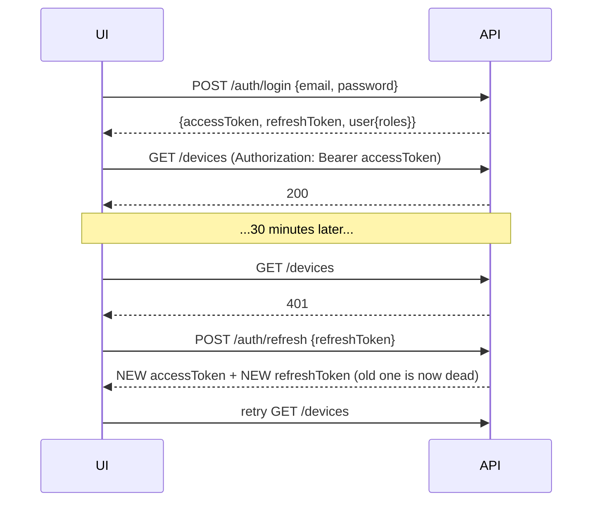
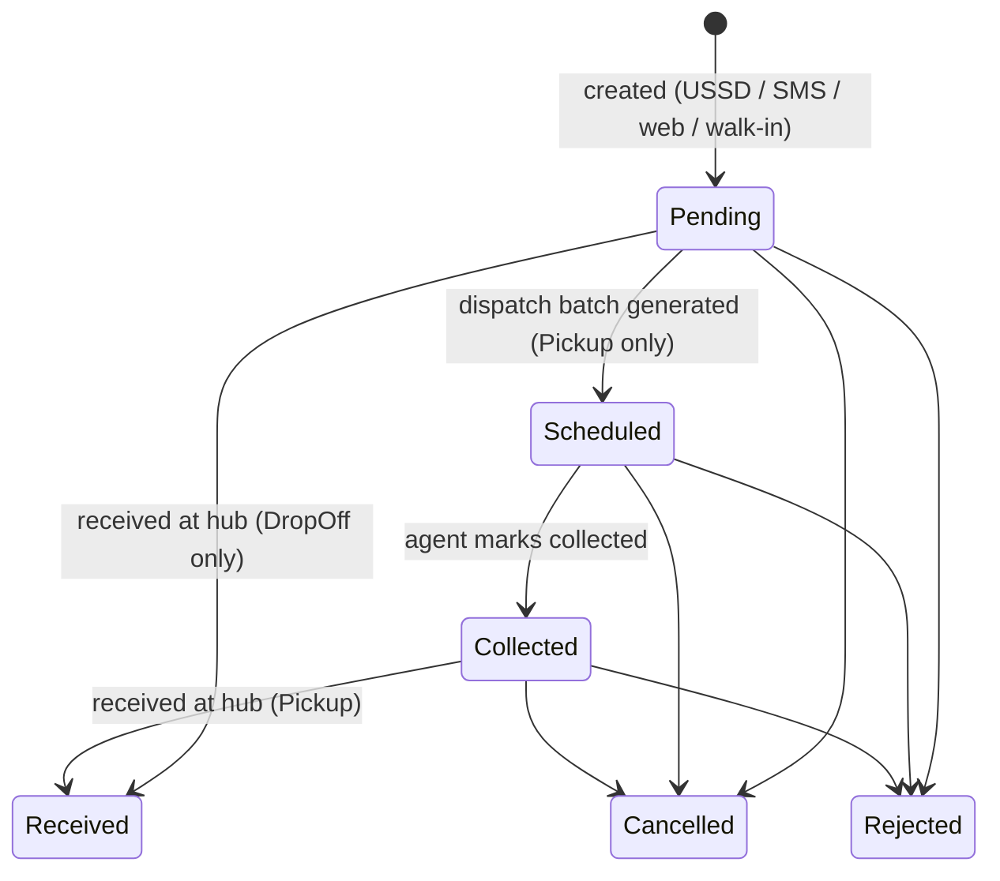
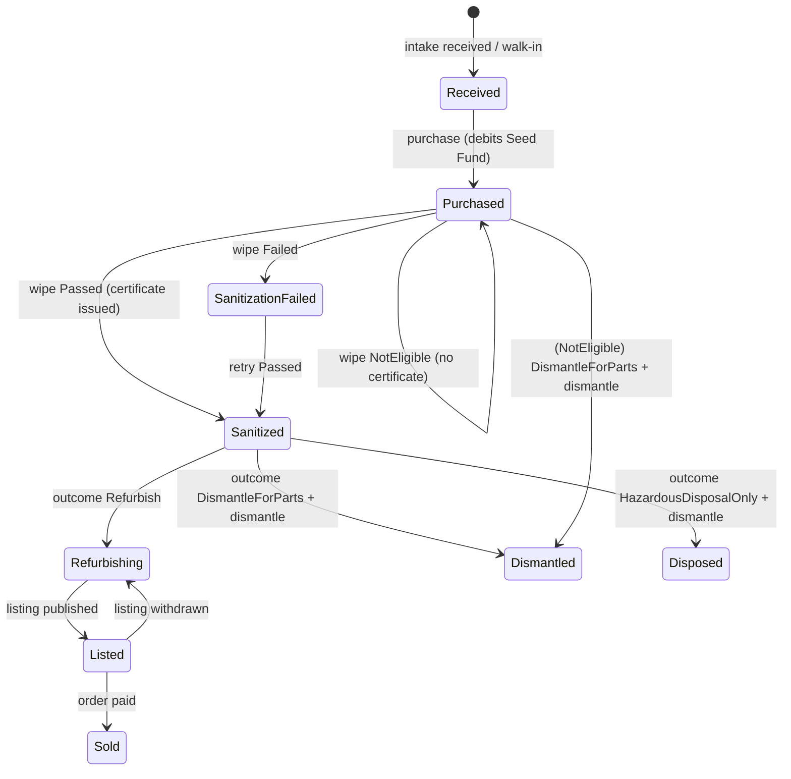

# CircuLedger API: Frontend Integration Guide

This guide covers everything a frontend developer needs to integrate the **Admin/Operations Dashboard**, the
**Field Agent / Technician app**, and the **public Marketplace** with the CircuLedger API.

> **Tip:** the live, always-current schema is at **`/openapi/v1.json`**. Swagger UI is at **`/swagger`**.
> You can generate typed clients from it (for example `npx openapi-typescript http://localhost:5097/openapi/v1.json -o src/api/schema.d.ts`).
> This document explains the *behaviour* that a schema can't: flows, rules, errors and which screen uses what.

---

## Table of contents

1. [Basics](#1-basics): base URLs, formats, conventions
2. [Authentication](#2-authentication): login, tokens, refresh, roles
3. [Errors](#3-errors): ProblemDetails, validation errors, error codes
4. [Pagination, filtering and sorting](#4-pagination-filtering-and-sorting)
5. [Files: uploads, PDFs, images, CSV](#5-files-uploads-pdfs-images-csv)
6. [Enums (allowed values)](#6-enums-allowed-values)
7. [Lifecycles (state machines)](#7-lifecycles-state-machines): which buttons to show when
8. [Endpoint reference](#8-endpoint-reference)
   - 8.1 [Auth](#81-auth) · 8.2 [Users](#82-users) · 8.3 [Public (no login)](#83-public-no-login)
   - 8.4 [Drop-off points](#84-drop-off-points) · 8.5 [Intake requests](#85-intake-requests) · 8.6 [Dispatch](#86-dispatch-pickup-batches)
   - 8.7 [Devices](#87-devices) · 8.8 [Purchasing](#88-purchasing) · 8.9 [Pricing](#89-pricing-matrix)
   - 8.10 [Sanitization](#810-sanitization) · 8.11 [Certificates](#811-certificates) · 8.12 [Recovery](#812-recovery-dismantling-components-hazardous-materials)
   - 8.13 [Listings](#813-listings-staff) · 8.14 [Orders](#814-orders) · 8.15 [Funds and reinvestment](#815-funds-and-reinvestment)
   - 8.16 [Training, jobs, awareness](#816-training-employment-awareness) · 8.17 [Dashboard](#817-dashboard-and-reports) · 8.18 [Ledger](#818-traceability-ledger)
   - 8.19 [USSD and SMS webhooks](#819-ussd-and-sms-webhooks-for-testing--simulators) · 8.20 [Health](#820-health)
9. [Screen → endpoint map](#9-screen--endpoint-map)
10. [End-to-end walkthrough](#10-end-to-end-walkthrough)
11. [TypeScript types](#11-typescript-types)
12. [Reference API client (fetch + auto refresh)](#12-reference-api-client-fetch--auto-refresh)
13. [Checklist and gotchas](#13-checklist-and-gotchas)

---

## 1. Basics

| Environment | Base URL | Swagger |
|---|---|---|
| Local (`dotnet run`) | `http://localhost:5097` | `http://localhost:5097/swagger` |
| Docker compose | `http://localhost:8080` | `http://localhost:8080/swagger` |
| Production | your deployed URL (ask the backend team) | usually enabled for the pilot |

All business endpoints live under **`/api/v1`**. In this document, paths like `/devices` mean `{BASE}/api/v1/devices`.
The only unversioned endpoints are `/health`, `/swagger` and `/openapi/v1.json`.

### Conventions

| Topic | Rule |
|---|---|
| Body format | JSON (`Content-Type: application/json`), except file uploads (`multipart/form-data`) and the USSD/SMS webhooks (`application/x-www-form-urlencoded`). |
| Property names | **camelCase** in both requests and responses (`trackingId`, `priceSle`). |
| Enums | Sent and returned as **strings**, e.g. `"BrokenScreen"`, `"OrangeMoney"`. Use the exact names in [§6](#6-enums-allowed-values). |
| IDs | GUID strings, e.g. `"01a18c45-62ea-7a2a-bab0-d67743d14a99"`. User IDs are also strings (GUID-like). |
| Date-times | ISO-8601 **UTC**, e.g. `"2026-10-30T09:20:00Z"`. Always send UTC (with `Z`). Convert to local time only for display (Sierra Leone is UTC+0 anyway). |
| Dates (no time) | `"YYYY-MM-DD"`, e.g. `"2026-11-03"` (training dates, campaign dates, batch `scheduledFor`, time-series `weekStart`). |
| Money | JSON **numbers** in Sierra Leonean Leone (**SLE**), up to 2 decimals. Field names end in `Sle`. Display as `SLE 1,200.00`. |
| Weights | kg as numbers with up to 3 decimals (`0.045`). |
| Null | Optional fields may be `null` or omitted in requests. Responses always include the property (value `null` when empty). |
| Personal data | Phone numbers are **never** returned in full except by one dedicated endpoint for field agents ([§8.6](#86-dispatch-pickup-batches)). You'll see masks like `"+232 ** *** 3456"` and IMEIs like `"***********3809"`. |
| Status codes | `200` OK, `201` Created (with `Location` header), `204` No Content, `400` validation, `401` not signed in, `403` not allowed, `404` not found, `409` conflict, `422` business rule, `429` rate limited, `500` server error. |

### CORS

The API only accepts browser calls from configured origins. By default these are `http://localhost:3000` and
`http://localhost:5173`. Ask the backend team to add your dev/prod origin (`Cors__AllowedOrigins__N` env vars).
Exposed response headers: `api-supported-versions`, `Content-Disposition` (use it to read download file names).

### Rate limits

Per client IP, per minute: **public** endpoints 60, **auth** endpoints 10, **USSD/SMS** 300. If you exceed a
limit you get `429 Too Many Requests`. Back off and retry later. Don't poll public endpoints in tight loops.

---

## 2. Authentication

The API uses **JWT bearer access tokens** (valid **30 minutes**) and **refresh tokens** (valid **14 days**,
**single-use**, rotated on every refresh).

```
Authorization: Bearer <accessToken>
```

### Login flow



**Rules your client must follow**

1. Store `accessToken` in memory, and the `refreshToken` somewhere that survives reloads
   (`localStorage` is acceptable for the pilot; an httpOnly cookie via a BFF is better for production).
2. On `401`, call `/auth/refresh` **once**, replace **both** tokens, and retry the original request.
3. **Never** refresh twice in parallel with the same refresh token. If you reuse an old refresh token, the API
   treats it as theft and **revokes every session** for that user (all devices get logged out). Use a single
   in-flight refresh promise (see [§12](#12-reference-api-client-fetch--auto-refresh)).
4. On logout, call `/auth/logout` with the refresh token, then clear storage.
5. After **5 wrong passwords** the account is locked for **15 minutes** (`401` with "temporarily locked").

### Roles and what they unlock

| Role | Who | Typical app |
|---|---|---|
| `Admin` | Hub administrator | Dashboard (everything) |
| `OperationsLead` | Hub manager | Dashboard |
| `Technician` | Workshop staff | Workshop / technician app |
| `FieldAgent` | Pickup agents | Mobile field app |
| `Buyer` | Marketplace customers | Marketplace |
| `Citizen` | Phone sellers (registered online) | Citizen portal (optional; most use USSD) |

Policy groups used in the endpoint tables below:

| Group | Roles allowed |
|---|---|
| **Public** | anyone, no token |
| **Authenticated** | any signed-in user |
| **Ops** | Admin, OperationsLead |
| **Workshop** | Admin, OperationsLead, Technician |
| **Field** | Admin, OperationsLead, FieldAgent |
| **Staff** | Admin, OperationsLead, Technician, FieldAgent |
| **Buyer** | Buyer, Admin, OperationsLead |
| **Admin** | Admin only |

The user's roles come back in the login response (`user.roles`). Use them to show or hide menus. They're
also in the JWT payload as the `role` claim (a string if there's one role, an array if there are several).
JWT claims: `sub` (user id), `email`, `name`, `role`, `exp`.

> Hiding a button is **only UX**. The API enforces every rule; expect `403` if a user calls something their role
> doesn't allow.

### Demo accounts (development / demo environments only)

| Email | Role | Password |
|---|---|---|
| `admin@circuledger.local` | Admin | `ChangeMe!Admin2026` |
| `ops@circuledger.local` | OperationsLead | `ChangeMe!Demo2026` |
| `tech@circuledger.local` | Technician (safety-trained) | `ChangeMe!Demo2026` |
| `agent@circuledger.local` | FieldAgent | `ChangeMe!Demo2026` |
| `buyer@circuledger.local` | Buyer | `ChangeMe!Demo2026` |

---

## 3. Errors

Every error body is **RFC 7807 ProblemDetails** (`Content-Type: application/problem+json`).

### Standard error

```json
{
  "type": "https://httpstatuses.io/409",
  "title": "Insufficient funds",
  "status": 409,
  "detail": "Device Purchasing Seed Fund balance (SLE 120.00) is insufficient for SLE 200.00.",
  "instance": "POST /api/v1/devices/0b1.../purchase",
  "code": "insufficient_funds",
  "traceId": "0HNPMDNJ07FKT:00000001"
}
```

- Show `detail` to the user (it's written to be human-readable).
- Branch your logic on **`code`**, not on the text.
- Include `traceId` in "report a problem" dialogs. Backend logs are searchable by it.

### Validation error (400)

```json
{
  "title": "One or more validation errors occurred.",
  "status": 400,
  "errors": {
    "Phone": ["Enter a valid Sierra Leone phone number."],
    "Imei": ["IMEI must be 15 digits with a valid check digit."]
  },
  "traceId": "..."
}
```

- `errors` keys are the request property names in **PascalCase** (`Phone`, `PriceSle`, `DropOffPointId`).
  Lower-case the first letter to map them onto your form fields.
- If the JSON itself is malformed or an enum value is unknown, the keys look like `"$.condition"` or `"request"`.
  Show those as a general form error.

### Error codes

| HTTP | `code` | Meaning / what to do in the UI |
|---|---|---|
| 400 | *(errors object)* | Show field errors. |
| 401 | `unauthorized` (or no body) | Token missing or expired: refresh or redirect to login. On `/auth/login` it means wrong credentials or a locked account. |
| 403 | `forbidden` (or no body) | The role isn't allowed, **or** a business permission is missing (e.g. no safety training, verifying your own photo, another agent's batch). Show `detail`. |
| 404 | `not_found` | Item doesn't exist (or isn't public). |
| 409 | `insufficient_funds` | Seed Fund too low to buy the phone. Show the balance message; an Admin can add a grant ([§8.15](#815-funds-and-reinvestment)). |
| 409 | `already_purchased` | Device already bought. Refresh the page. |
| 409 | `duplicate_imei` | Another active device has this IMEI (possible duplicate or stolen phone). Ask staff to double-check. |
| 409 | `listing_unavailable` | Someone else reserved or bought the item. Refresh the cart. |
| 409 | `already_listed` | Device or component already has an active listing. |
| 409 | `certificate_exists`, `already_revoked`, `already_dismantled`, `payout_completed`, `already_reinvested` | Action already done. Refresh. |
| 409 | `no_field_agents` | No active FieldAgent users to assign batches to. |
| 409 | `duplicate` | A database uniqueness clash (rare). *Note: an email already registered at `/auth/register` or `POST /users` returns **400** with `errors.DuplicateEmail`.* |
| 422 | `photo_required` | Publish needs ≥ 1 **verified** photo. |
| 422 | `no_price` | No pricing-matrix row for this brand/condition and no agreed price was given. |
| 422 | `invalid_state_transition` | The item isn't in a state that allows this action (see [§7](#7-lifecycles-state-machines)). |
| 422 | `business_rule_violation` | Any other rule (e.g. a refurbish needs a certificate). Show `detail`. |
| 429 | – | Too many requests. Wait and retry. |
| 500 | `server_error` | Unexpected. Show a generic error with `traceId`. |

---

## 4. Pagination, filtering and sorting

List endpoints that can grow large return a **page envelope**:

```json
{
  "items": [ /* ... */ ],
  "page": 1,
  "pageSize": 20,
  "totalCount": 137,
  "totalPages": 7
}
```

| Query param | Default | Rules |
|---|---|---|
| `page` | `1` | minimum 1 |
| `pageSize` | `20` | clamped to 1–100 |

Filters are plain query parameters, e.g. `/devices?status=Sanitized&samsungOnly=true&page=2&pageSize=50`.
Enum filters take the enum **name**. Booleans are `true`/`false`. Dates are `YYYY-MM-DD`.
Some small lists (drop-off points, training cycles, employment, awareness) return a **plain array** instead of
a page envelope. Each endpoint below says which.

---

## 5. Files: uploads, PDFs, images, CSV

### Uploading a listing photo

`POST /listings/{id}/photos`, `multipart/form-data`, **field name must be `file`**.
Allowed: `image/jpeg`, `image/png`, `image/webp`, up to **5 MB**. The server checks the real file bytes, so a
renamed `.txt` is rejected even if you set `image/png`.

```ts
const form = new FormData();
form.append("file", fileInput.files[0]);           // don't set Content-Type yourself
await api(`/listings/${listingId}/photos`, { method: "POST", body: form });
```

### Downloading protected files (PDF certificate, QR, staff photos, CSV)

These require the `Authorization` header, so a plain `<a href>` or `` **won't work**. Fetch them as a blob:

```ts
const res = await api(`/certificates/${no}/pdf`, { raw: true });   // see §12 client
const blob = await res.blob();
const url = URL.createObjectURL(blob);
window.open(url);                     // or: <a download href={url}>
// Revoke the object URL when you're done: URL.revokeObjectURL(url)
```

The suggested file name is in the `Content-Disposition` header (e.g. `CDS-2026-000045.pdf`).

### Public images (marketplace)

Photo objects returned by **public** listing endpoints have a **relative** `url`, e.g.
`/api/v1/public/listings/{id}/photos/{photoId}`. Prefix it with the base URL and use it directly:

```tsx

```

Public responses only include **verified** photos. Staff endpoints include unverified ones too; for those,
use the staff URL `/listings/{id}/photos/{photoId}` with a blob fetch.

---

## 6. Enums (allowed values)

Always send exactly these strings.

| Enum | Values | Notes / suggested labels |
|---|---|---|
| `Gender` | `Unspecified`, `Female`, `Male`, `Other` | Used for the ≥40% women inclusion KPI |
| `DropOffPointType` | `Hub`, `SolarMakit`, `Kiosk` | "Solar Makit" |
| `IntakeChannel` | `Ussd`, `Sms`, `DropOff`, `AgentPickup`, `Web` | |
| `FulfilmentMethod` | `DropOff`, `Pickup` | |
| `DeviceCondition` | `Dead`, `BrokenScreen`, `WorkingFaulty` | "Dead (won't switch on)", "Broken screen", "Working but faulty" |
| `IntakeStatus` | `Pending`, `Scheduled`, `Collected`, `Received`, `Rejected`, `Cancelled` | |
| `TransportMode` | `Foot`, `Bicycle`, `Motorcycle` | |
| `DispatchBatchStatus` | `Planned`, `InProgress`, `Completed`, `Cancelled` | |
| `DeviceStatus` | `Received`, `Purchased`, `Sanitized`, `SanitizationFailed`, `Refurbishing`, `Dismantled`, `Disposed`, `Listed`, `Sold` | |
| `PayoutMethod` | `Cash`, `OrangeMoney`, `Afrimoney` | "Orange Money" |
| `PayoutStatus` | `Pending`, `Paid`, `Failed` | |
| `SanitizationMethod` | `FactoryResetOverwrite`, `SamsungKnoxGradeErase`, `CryptographicErase`, `StoragePhysicalDestruction` | Knox is only for Samsung devices |
| `SanitizationOutcome` | `Passed`, `Failed`, `NotEligible` | Only `Passed` issues a certificate |
| `RecoveryOutcome` | `Refurbish`, `DismantleForParts`, `HazardousDisposalOnly` | |
| `ComponentType` | `Screen`, `Board`, `Battery`, `Camera`, `Housing`, `ChargingPort`, `Speaker`, `Other` | |
| `Grade` | `A`, `B`, `C`, `Salvage` | Listing condition and component grade |
| `ComponentStatus` | `InStock`, `Listed`, `Sold`, `Scrapped` | |
| `HazardousMaterial` | `LithiumBattery`, `Lead`, `Other` | |
| `ListingItemType` | `RefurbishedDevice`, `Component` | |
| `ListingStatus` | `Draft`, `Published`, `Reserved`, `Sold`, `Withdrawn` | |
| `OrderStatus` | `Pending`, `Paid`, `Fulfilled`, `Cancelled` | |
| `FundType` | `SeedFund`, `TrainingFund` | |
| `FundTransactionDirection` | `Credit`, `Debit` | |
| `FundTransactionReason` | `Grant`, `DevicePurchase`, `Reinvestment`, `TrainingExpense`, `Adjustment` | Manual: `Grant` (credit), `TrainingExpense` / `Adjustment` (debit) |
| `EnrollmentStatus` | `Enrolled`, `Completed`, `Dropped` | |
| `EmploymentType` | `FullTime`, `PartTime`, `Stipend`, `Apprenticeship` | |
| `InstitutionType` | `School`, `Campus`, `Community` | |
| `CampaignType` | `Talk`, `Workshop`, `Radio`, `CollectionDrive`, `SocialMedia` | |
| `LedgerEventType` | `IntakeCreated`, `DeviceReceived`, `Purchased`, `Sanitized`, `CertificateIssued`, `Dismantled`, `ComponentRecovered`, `MaterialDiverted`, `Listed`, `Sold`, `Reinvested` | |
| Roles | `Admin`, `OperationsLead`, `Technician`, `FieldAgent`, `Buyer`, `Citizen` | |

---

## 7. Lifecycles (state machines)

Use these to decide **which action buttons to show** for each record.

### Intake request



| Status | Buttons (role) |
|---|---|
| `Pending` + `DropOff` | **Receive** (Staff), Cancel/Reject (Ops) |
| `Pending` + `Pickup` | Set location (Field) if no coordinates; included in **Generate batches** (Ops); Cancel/Reject (Ops) |
| `Scheduled` | Agent: **Call seller**, **Mark collected**; Cancel/Reject (Ops) |
| `Collected` | **Receive** (Staff); Cancel/Reject (Ops) |
| `Received` | Go to device (`deviceTrackingId`) |

### Device



| Device status | Next actions (role) |
|---|---|
| `Received` | **Purchase** (Ops) |
| `Purchased` | **Record sanitization** (Workshop). If a previous record was `NotEligible`: **Set outcome** Dismantle/Hazardous (Workshop) |
| `SanitizationFailed` | **Record sanitization** again (Workshop) |
| `Sanitized` | **Set recovery outcome** (Workshop): Refurbish / DismantleForParts / HazardousDisposalOnly |
| `Refurbishing` | **Create listing** (Ops) |
| `Sanitized`/`Purchased` with outcome DismantleForParts or HazardousDisposalOnly | **Dismantle** (Workshop, safety-trained) |
| `Dismantled` | **Add component**, **Log hazardous material** (Workshop, safety-trained) |
| `Disposed` | **Log hazardous material** |
| `Listed`, `Sold` | View only |

### Listing

`Draft` → (≥1 verified photo) **Publish** → `Published` → buyer orders → `Reserved` → order paid → `Sold`.
`Published`/`Draft` → **Withdraw** → `Withdrawn` → **Publish** again. If an order is cancelled, `Reserved` goes back to `Published`.
Editing is allowed in `Draft`, `Published` and `Withdrawn` (not in `Reserved` or `Sold`).

### Order

`Pending` → **Pay** (Ops confirms payment) → `Paid` → **Fulfil** (Ops) → `Fulfilled`.
`Pending` → **Cancel** (buyer or Ops, with a required `reason`) → `Cancelled`. Only `Pending` orders can be cancelled.

---

## 8. Endpoint reference

Format of each entry: **METHOD path** · *who can call it* · what it does, then the request and response.
All paths are relative to `{BASE}/api/v1`.

### 8.1 Auth

#### `POST /auth/register` · Public
Self-registration for **Buyer** (default) or **Citizen** accounts. Staff accounts are created by an Admin ([§8.2](#82-users)).

```json
{
  "email": "aminata@example.com",
  "password": "MySecurePass1",
  "fullName": "Aminata Conteh",
  "gender": "Female",
  "accountType": "Buyer",
  "phone": null
}
```

| Field | Required | Rules |
|---|---|---|
| `email` | ✔ | valid email, unique |
| `password` | ✔ | ≥ 10 chars, with **upper-case, lower-case and a digit** |
| `fullName` | ✔ | ≤ 150 chars |
| `gender` | – | `Gender` enum (default `Unspecified`) |
| `accountType` | – | `"Buyer"` (default) or `"Citizen"` |
| `phone` | only for Citizen | the number they use for USSD, e.g. `"076123456"` or `"+23276123456"`. It links their past USSD requests to the account. |

**200** → `AuthResponse` (same as login, so the user is signed in straight away).

#### `POST /auth/login` · Public
```json
{ "email": "ops@circuledger.local", "password": "ChangeMe!Demo2026" }
```
**200** → `AuthResponse`
```json
{
  "accessToken": "eyJhbGciOi...",
  "accessTokenExpiresAt": "2026-10-30T10:39:43Z",
  "refreshToken": "q1J0...base64...",
  "refreshTokenExpiresAt": "2026-11-13T10:09:43Z",
  "user": {
    "id": "6f1c0c9e-...",
    "email": "ops@circuledger.local",
    "fullName": "Aminata Kamara",
    "gender": "Female",
    "maskedPhone": "+232 ** *** 3456",
    "roles": ["OperationsLead"],
    "isActive": true,
    "createdAt": "2026-10-30T10:09:15Z"
  }
}
```
**401** wrong credentials, inactive or locked account.

#### `POST /auth/refresh` · Public
```json
{ "refreshToken": "q1J0...base64..." }
```
**200** → a new `AuthResponse` (**both tokens are new**; the old refresh token is dead).
**401** expired, revoked, or reused token. Send the user to the login screen.

#### `POST /auth/logout` · Public
```json
{ "refreshToken": "q1J0...base64..." }
```
**204** (always, even if the token was already invalid).

---

### 8.2 Users

> Building the "My profile" screens? **[PROFILE_MANAGEMENT.md](PROFILE_MANAGEMENT.md)** has the flows, form
> rules, error mapping and ready-to-use code for the `/users/me` endpoints below.

#### `GET /users/me` · Authenticated
**200** → `UserProfile` (see the `user` object above).

#### `PUT /users/me` · Authenticated
```json
{ "fullName": "Aminata K. Kamara", "gender": "Female" }
```
**200** → `UserProfile`.

#### `PUT /users/me/password` · Authenticated
```json
{ "currentPassword": "old password", "newPassword": "at least 10 characters" }
```
**200** → a new `AuthResponse`. **Replace both stored tokens with the ones returned.** Every refresh token issued
before the change is revoked, so the user is signed out on all other devices.
**400** `errors.CurrentPassword` (wrong current password), or the new password is too short, too weak, or the same as the current one.
**401** the account is locked after repeated wrong current passwords (same lockout as login).

#### `PUT /users/me/email` · Authenticated
```json
{ "newEmail": "aminata.k@example.com", "currentPassword": "current password" }
```
**200** → `UserProfile`. The new email is the login from now on. The `email` claim inside the current access token
stays old until the next `/auth/refresh`, so read the email from this response or from `GET /users/me`.
**400** `errors.CurrentPassword` (wrong password), `errors.DuplicateEmail` (already in use), or an invalid address.
**401** the account is locked (same lockout as login).

#### `PUT /users/me/phone` · Authenticated
```json
{ "phone": "+23276123456", "currentPassword": "current password" }
```
Accepts `+232XXXXXXXX`, `0XXXXXXXX` or an 8-digit local number.
**200** → `UserProfile` with `maskedPhone` updated (the full number is never returned).
For **Citizen** accounts, USSD/SMS sell requests from the new number now appear under `GET /users/me/intake-requests`.
The old number is released, so requests made from it are no longer listed.
**400** `errors.CurrentPassword`, `errors.Phone` (invalid, or already linked to another citizen account).
**401** the account is locked (same lockout as login).

#### `GET /users/me/intake-requests` · Citizen
A registered citizen's own sell requests (matched by the phone number they registered with).
**200** → `IntakeRequest[]` (plain array, see [§8.5](#85-intake-requests)).

#### `GET /users` · Admin
Query: `role` (e.g. `FieldAgent`), `search` (name/email), `page`, `pageSize`.
**200** → `Paged<UserProfile>`.
*Tip:* use `GET /users?role=FieldAgent&pageSize=100` to populate an "assign agent" dropdown.

#### `POST /users` · Admin
Creates a staff account.
```json
{
  "email": "musa@circuledger.local",
  "password": "TempPassw0rd!",
  "fullName": "Musa Koroma",
  "gender": "Male",
  "roles": ["FieldAgent"]
}
```
**200** → `UserProfile`. **400** if the email is taken or the password is too weak (errors keyed by Identity codes, e.g. `DuplicateEmail`, `PasswordRequiresUpper`).

#### `PUT /users/{id}/roles` · Admin
Replaces the user's roles.
```json
{ "roles": ["Technician", "FieldAgent"] }
```
**200** → `UserProfile`. Changes apply at the user's next login or token refresh.

#### `PUT /users/{id}/active?value=false` · Admin
Deactivates (`false`) or re-activates (`true`) an account. No body. **200** → `UserProfile`.
Deactivated users can't log in or refresh.

---

### 8.3 Public (no login)

Use these for the **marketplace**, the **certificate verification page** (the target of the QR code) and the public **"where to drop off"** map.

#### `GET /public/certificates/{certificateNumber}/verify` · Public
Example: `/public/certificates/CDS-2026-000045/verify`
**200** (valid, revoked or tampered) or **404** (unknown number). Both return this body:
```json
{
  "certificateNumber": "CDS-2026-000045",
  "isValid": true,
  "status": "Valid",
  "issuedAt": "2026-10-30T09:21:04.123456Z",
  "issuer": "Smart Youth Mobile Circularity Hub, Njala University",
  "device": "Samsung Galaxy A14",
  "maskedImei": "***********3809",
  "method": "SamsungKnoxGradeErase",
  "passes": 1,
  "payloadHash": "467eda3750...",
  "reason": null
}
```
`status` is one of `Valid`, `Revoked`, `Invalid` (data or signature doesn't match), `NotFound`.
UI: big green tick for `Valid`. For anything else, red/amber with the `reason`.

> **Verify page route.** The QR code on the PDF points to the API URL
> `{PublicBaseUrl}/api/v1/public/certificates/{no}/verify`, which returns JSON. If you build a pretty verify page
> (e.g. `https://hub.example/verify/CDS-2026-000045`), ask the backend team to set `Hub:PublicBaseUrl` so the QR
> points to your page, and have that page call this endpoint.

#### `GET /public/certificates/signing-key` · Public
```json
{ "keyId": "a1b2c3d4e5f60718", "algorithm": "RS256", "publicKeyPem": "-----BEGIN PUBLIC KEY-----\n..." }
```
Only needed if you show an "advanced / verify it yourself" panel.

#### `GET /public/drop-off-points` · Public
**200** → `DropOffPoint[]` (active points only, plain array, ordered for display)
```json
[
  {
    "id": "0193...",
    "name": "Njala Hub",
    "type": "Hub",
    "latitude": 8.1137,
    "longitude": -12.0798,
    "landmark": "Njala University campus, ICT block",
    "openingHours": "Mon-Sat 09:00-17:00",
    "isActive": true,
    "displayOrder": 1
  }
]
```
Use it for a map (Leaflet/Google Maps) and a list.

#### `GET /public/pricing/quote?brand=Samsung&condition=BrokenScreen` · Public
**200**
```json
{ "brand": "Samsung", "condition": "BrokenScreen", "priceSle": 200.00, "matchedBrand": "Samsung" }
```
`priceSle` is `null` if no price is configured. `matchedBrand` is `"*"` when the generic "any brand" price was used.
Use it for a "How much is my phone worth?" widget.

#### `GET /public/listings` · Public
Marketplace browse/search. Only `Published` listings are returned.

| Query | Type | Example |
|---|---|---|
| `search` | text (title, brand or model contains) | `galaxy` |
| `brand` | exact brand (case-insensitive) | `Samsung` |
| `itemType` | `RefurbishedDevice` \| `Component` | |
| `componentType` | `ComponentType` | `Screen` |
| `condition` | `Grade` | `A` |
| `minPrice`, `maxPrice` | number (SLE) | `500`, `2000` |
| `samsungOnly` | bool | `true` |
| `sort` | `newest` (default) \| `price_asc` \| `price_desc` | |
| `page`, `pageSize` | int | |

**200** → `Paged<Listing>`
```json
{
  "items": [
    {
      "id": "01a18c45-62ea-7a2a-bab0-d67743d14a99",
      "listingCode": "LST-000012",
      "itemType": "RefurbishedDevice",
      "title": "Samsung Galaxy A14 - refurbished, new screen",
      "description": "Data wiped with Knox-grade erase.",
      "brand": "Samsung",
      "model": "Galaxy A14",
      "isSamsung": true,
      "componentType": null,
      "priceSle": 1200.00,
      "condition": "B",
      "warrantyDays": 90,
      "status": "Published",
      "publishedAt": "2026-10-30T09:40:00Z",
      "certificateNumber": "CDS-2026-000045",
      "certificateVerificationUrl": "https://hub.example/api/v1/public/certificates/CDS-2026-000045/verify",
      "photos": [
        {
          "id": "01a18c46-...",
          "url": "/api/v1/public/listings/01a18c45-.../photos/01a18c46-...",
          "contentType": "image/png",
          "sizeBytes": 183422,
          "sha256": "9f8e...",
          "uploadedAt": "2026-10-30T09:35:00Z",
          "isVerified": true,
          "verifiedAt": "2026-10-30T09:36:10Z"
        }
      ]
    }
  ],
  "page": 1, "pageSize": 20, "totalCount": 1, "totalPages": 1
}
```
**Trust badge:** when `certificateNumber` is present, show "Data securely wiped ✓ Certificate CDS-…" linking to your verify page.

#### `GET /public/listings/{id}` · Public
**200** → `Listing`. **404** if not published.

#### `GET /public/listings/{id}/photos/{photoId}` · Public
Returns the image bytes (`image/jpeg|png|webp`), cacheable for 1 hour. Use it directly in ``.

---

### 8.4 Drop-off points

| Method & path | Access | Purpose |
|---|---|---|
| `GET /drop-off-points?includeInactive=true` | Staff | List all (array). `includeInactive` defaults to false |
| `GET /drop-off-points/{id}` | Staff | One point |
| `POST /drop-off-points` | Ops | Create, **201** + `Location` |
| `PUT /drop-off-points/{id}` | Ops | Update (send the full object) |
| `DELETE /drop-off-points/{id}` | Ops | Soft delete, **204** |

Create/update body:
```json
{
  "name": "Kiosk Bo/Kowama",
  "type": "Kiosk",
  "latitude": 7.9523,
  "longitude": -11.7296,
  "landmark": "Kowama, Bo",
  "openingHours": "Mon-Sun 09:00-19:00",
  "isActive": true,
  "displayOrder": 4
}
```
Rules: `name` ≤120, `latitude` between **6.8 and 10.1**, `longitude` between **−13.4 and −10.2** (Sierra Leone;
this catches swapped lat/lng), `openingHours` required ≤120. `displayOrder` sets the order in the USSD menu.
*Tip:* temporarily closing a point = `isActive: false` (it disappears from USSD and public lists).

---

### 8.5 Intake requests

A citizen's offer to sell **one** phone. Most arrive via USSD/SMS; staff can also create them.

`IntakeRequest` object:
```json
{
  "id": "01a18c3f-...",
  "referenceCode": "SY56JDVN",
  "citizenPhoneMasked": "+232 ** *** 3456",
  "brand": "Samsung",
  "model": null,
  "reportedCondition": "BrokenScreen",
  "channel": "Ussd",
  "fulfilmentMethod": "Pickup",
  "dropOffPointId": null,
  "dropOffPointName": null,
  "pickupArea": "Towama layout",
  "pickupLatitude": 7.9786,
  "pickupLongitude": -11.7519,
  "estimatedOfferSle": 200.00,
  "status": "Pending",
  "dispatchBatchId": null,
  "createdAt": "2026-10-30T08:00:00Z",
  "scheduledAt": null,
  "collectedAt": null,
  "receivedAt": null,
  "closedReason": null,
  "deviceTrackingId": null
}
```

#### `POST /intake-requests` · Staff, Citizen
Creates a request on behalf of a seller (web/phone channel). **201**.
```json
{
  "phone": "076123456",
  "brand": "Tecno",
  "model": "Spark 7",
  "condition": "Dead",
  "fulfilmentMethod": "DropOff",
  "dropOffPointId": "0193...",
  "pickupArea": null,
  "pickupLatitude": null,
  "pickupLongitude": null,
  "channel": "Web"
}
```
| Field | Rules |
|---|---|
| `phone` | required. Accepts `076123456`, `76123456`, `+23276123456`, `23276123456` (and other E.164 `+…` numbers) |
| `brand` | required ≤ 50 |
| `condition`, `fulfilmentMethod` | required enums |
| `dropOffPointId` | required when `fulfilmentMethod = DropOff` (must be active) |
| `pickupArea` | required when `Pickup`, ≤ 160. Known towns/landmarks (Njala, Bo, Towama, Kowama, Kpetema, Tikonko…) are geocoded automatically |
| `pickupLatitude/Longitude` | optional, **both or neither**; within Sierra Leone bounds |

The seller gets an SMS with the reference code. **201** → `IntakeRequest`.

#### `GET /intake-requests` · Staff
Query: `status`, `fulfilmentMethod`, `channel`, `referenceCode`, `page`, `pageSize`. Newest first.
**200** → `Paged<IntakeRequest>`.
*Useful views:* "Awaiting pickup" = `?status=Pending&fulfilmentMethod=Pickup`; "Search by ref" = `?referenceCode=SY56JDVN`.

#### `GET /intake-requests/{id}` · Staff
**200** → `IntakeRequest`.

#### `PUT /intake-requests/{id}/pickup-location` · Field
For pending pickups that have **no coordinates** (`pickupLatitude: null`). These are skipped by batching. Use the
device GPS (`navigator.geolocation`) or a map picker.
```json
{ "latitude": 7.9601, "longitude": -11.7402, "pickupArea": "Near Bo Government Hospital" }
```
**200** → `IntakeRequest`. **422** if it's not a pending pickup.

#### `POST /intake-requests/{id}/cancel` · Ops
#### `POST /intake-requests/{id}/reject` · Ops
```json
{ "reason": "Seller no longer wants to sell" }
```
**200** → `IntakeRequest`. Reject also SMSes the seller with the reason.

#### `POST /intake-requests/{id}/receive` · Staff
The phone has physically arrived at a hub. This creates the **Device** and its **tracking ID**.
Allowed when the request is `Pending` (drop-off) or `Collected` (pickup).
```json
{
  "dropOffPointId": "0193...",
  "imei": "352099001761481",
  "brand": null,
  "model": "Galaxy A14",
  "assessedCondition": "BrokenScreen"
}
```
| Field | Rules |
|---|---|
| `dropOffPointId` | required: where it was received |
| `imei` | optional, 15 digits with a valid Luhn check digit (dial `*#06#` on the phone). Spaces/dashes are ignored |
| `brand`, `model`, `assessedCondition` | optional corrections after inspection; otherwise the seller's values are kept |

**200** → `Device` ([§8.7](#87-devices)). **409 `duplicate_imei`** if an active device already has this IMEI.

#### `POST /intake-requests/walk-in` · Staff
A seller walks into a hub with no prior request: creates the request **and** the device in one call.
```json
{
  "phone": "+23277123456",
  "brand": "Samsung",
  "model": "Galaxy J7",
  "imei": "490154203237518",
  "condition": "WorkingFaulty",
  "dropOffPointId": "0193..."
}
```
**200** → `Device`.

---

### 8.6 Dispatch (pickup batches)

`DispatchBatch` object:
```json
{
  "id": "01a18c41-...",
  "batchCode": "DB-20261031-0003",
  "fieldAgentUserId": "9a7e...",
  "fieldAgentName": "Mohamed Bangura",
  "transportMode": "Bicycle",
  "status": "Planned",
  "centroidLatitude": 7.9655,
  "centroidLongitude": -11.7408,
  "radiusKm": 5,
  "spreadKm": 1.912,
  "scheduledFor": "2026-10-31",
  "pickups": [
    {
      "intakeRequestId": "01a18c3f-...",
      "referenceCode": "SY56JDVN",
      "brand": "Samsung",
      "condition": "BrokenScreen",
      "pickupArea": "Towama layout",
      "latitude": 7.9786,
      "longitude": -11.7519,
      "status": "Scheduled",
      "citizenPhoneMasked": "+232 ** *** 3456",
      "collectedAt": null
    }
  ]
}
```

#### `POST /dispatch/batches/generate` · Ops
Groups all `Pending` pickup requests that **have coordinates** into batches by distance, and assigns each batch to a field agent (least-loaded first, round-robin).
```json
{
  "radiusKm": 3,
  "maxPerBatch": 10,
  "fieldAgentIds": ["9a7e..."],
  "transportMode": null,
  "scheduledFor": "2026-10-31"
}
```
All fields are optional (`{}` is valid). Defaults: radius 3 km, max 10, all active field agents, transport auto-suggested from spread (≤1.5 km Foot, ≤6 km Bicycle, otherwise Motorcycle), scheduled for tomorrow.
Ranges: `radiusKm` 0.1–50, `maxPerBatch` 1–50.

**200**
```json
{ "batches": [ /* DispatchBatch */ ], "requestsBatched": 7, "unlocatedRequests": 2 }
```
If `unlocatedRequests > 0`, show a warning with a link to the "Pending pickups without location" list (`pickupLatitude == null`) so someone can set coordinates.
**409 `no_field_agents`** if there are no active FieldAgent accounts. Sellers are SMS'd with their pickup date.

#### `GET /dispatch/batches` · Ops
Query: `status`, `fieldAgentUserId`, `page`, `pageSize`. **200** → `Paged<DispatchBatch>`.

#### `GET /dispatch/batches/{id}` · Field (agents: only their own)
**200** → `DispatchBatch`. **403** for another agent's batch.

#### `GET /dispatch/my-batches` · Field
The signed-in agent's open (`Planned`/`InProgress`) batches, soonest first. **200** → `DispatchBatch[]`.
This is the home screen of the field app. Show pickups on a map using `latitude/longitude`.

#### `GET /dispatch/batches/{id}/pickups/{intakeRequestId}/contact` · Field (assigned agent)
Reveals the seller's **full phone number** so the agent can call them. Every access is logged.
Only works while the pickup is `Scheduled`.
```json
{ "intakeRequestId": "01a18c3f-...", "referenceCode": "SY56JDVN", "phone": "+23276123456", "pickupArea": "Towama layout" }
```
UI: show a **"Call seller"** button that fetches this on tap and opens `tel:+23276123456`. **Don't** cache the
number or prefetch it for the whole list.

#### `POST /dispatch/batches/{id}/pickups/{intakeRequestId}/collect` · Field (assigned agent)
No body. Marks the pickup collected. When all pickups are done, the batch becomes `Completed`.
**200** → updated `DispatchBatch`. The seller gets an SMS.

---

### 8.7 Devices

`Device` object:
```json
{
  "id": "01a18c42-...",
  "trackingId": "CL-2026-000123",
  "brand": "Samsung",
  "model": "Galaxy A14",
  "maskedImei": "***********1481",
  "condition": "BrokenScreen",
  "isSamsungFlagship": true,
  "intakeChannel": "Ussd",
  "status": "Purchased",
  "recoveryOutcome": null,
  "locationId": "0193...",
  "locationName": "Njala Hub",
  "intakeReference": "SY56JDVN",
  "certificateNumber": null,
  "purchase": {
    "paidPriceSle": 200.00,
    "payoutMethod": "OrangeMoney",
    "payoutStatus": "Pending",
    "purchasedAt": "2026-10-30T09:10:00Z"
  },
  "createdAt": "2026-10-30T09:05:00Z"
}
```

| Method & path | Access | Purpose |
|---|---|---|
| `GET /devices` | Staff | List. Query: `status`, `brand`, `samsungOnly`, `search` (tracking ID or model), `page`, `pageSize` → `Paged<Device>` |
| `GET /devices/{id}` | Staff | One device |
| `GET /devices/tracking/{trackingId}` | Staff | Look up by tracking ID (e.g. scanned from a label: `CL-2026-000123`) |

*Tip:* print the `trackingId` as a barcode/QR label at receipt; the workshop app scans it and calls `/devices/tracking/{trackingId}`.

---

### 8.8 Purchasing

#### `POST /devices/{id}/purchase` · Ops
Buys the device. The price comes from the pricing matrix (brand × condition) unless `agreedPriceSle` is given.
The price is **debited from the Seed Fund**, and the seller gets an SMS.
```json
{ "payoutMethod": "OrangeMoney", "agreedPriceSle": null, "payoutReference": null }
```
| Field | Rules |
|---|---|
| `payoutMethod` | required: `Cash`, `OrangeMoney`, `Afrimoney` |
| `agreedPriceSle` | optional override, > 0 and < 100,000 |
| `payoutReference` | optional ≤ 100 (mobile-money transaction ID) |

**200** → `Purchase`
```json
{
  "id": "01a18c43-...",
  "deviceId": "01a18c42-...",
  "trackingId": "CL-2026-000123",
  "offeredPriceSle": 200.00,
  "paidPriceSle": 200.00,
  "payoutMethod": "OrangeMoney",
  "payoutStatus": "Pending",
  "payoutReference": null,
  "payoutCompletedAt": null,
  "createdAt": "2026-10-30T09:10:00Z"
}
```
Errors: **409 `insufficient_funds`** (show "Seed Fund too low: balance SLE X"), **409 `already_purchased`**,
**422 `no_price`**, **422** if the device isn't in `Received`.
*UX tip:* before confirming, call `/public/pricing/quote?brand=…&condition=…` and `GET /funds` to show the offer and the remaining balance.

#### `GET /devices/{id}/purchase` · Staff
**200** → `Purchase`. **404** if not purchased yet.

#### `PUT /devices/{id}/purchase/payout` · Ops
Records the payout result after paying the seller.
```json
{ "status": "Paid", "payoutReference": "OM-TXN-445566" }
```
`payoutReference` is **required when `status` = `Paid`**. Once `Paid`, it can't be changed (**409 `payout_completed`**).
**200** → `Purchase`.

---

### 8.9 Pricing matrix

#### `GET /pricing/matrix` · Staff
**200** → `PricingRule[]`
```json
[ { "id": "...", "brand": "Samsung", "condition": "Dead", "priceSle": 60.00, "isActive": true },
  { "id": "...", "brand": "*", "condition": "Dead", "priceSle": 15.00, "isActive": true } ]
```
Brand `"*"` is the fallback for any brand without its own row.
UI suggestion: render a grid with brands as rows and the 3 conditions as columns.

#### `PUT /pricing/matrix` · Ops
Creates or updates one cell (matched by brand + condition).
```json
{ "brand": "Samsung", "condition": "BrokenScreen", "priceSle": 220, "isActive": true }
```
`priceSle` 0 to < 100,000. **200** → `PricingRule`.

---

### 8.10 Sanitization

#### `POST /devices/{id}/sanitizations` · Workshop
Records a data wipe. Device must be `Purchased` or `SanitizationFailed`.
```json
{
  "method": "SamsungKnoxGradeErase",
  "startedAt": "2026-10-30T09:00:00Z",
  "completedAt": "2026-10-30T09:20:00Z",
  "passes": 1,
  "outcome": "Passed",
  "toolName": "Samsung Knox Wipe",
  "notes": null
}
```
| Field | Rules |
|---|---|
| `method` | `SanitizationMethod`. `SamsungKnoxGradeErase` only for Samsung devices (**422** otherwise) |
| `startedAt` ≤ `completedAt` | UTC; `completedAt` can't be in the future |
| `passes` | 1–35 |
| `outcome` | `Passed` → certificate issued; `Failed` → device `SanitizationFailed` (retry later); `NotEligible` → no certificate, device can only be dismantled or disposed of |
| `notes` | **required** when outcome isn't `Passed` (≤ 1000) |
| `toolName` | optional ≤ 100 |

**200** → `SanitizationRecord`
```json
{
  "id": "...",
  "deviceId": "...",
  "trackingId": "CL-2026-000123",
  "method": "SamsungKnoxGradeErase",
  "technicianUserId": "...",
  "startedAt": "2026-10-30T09:00:00Z",
  "completedAt": "2026-10-30T09:20:00Z",
  "passes": 1,
  "outcome": "Passed",
  "toolName": "Samsung Knox Wipe",
  "notes": null,
  "certificate": {
    "id": "...",
    "certificateNumber": "CDS-2026-000045",
    "deviceId": "...",
    "trackingId": "CL-2026-000123",
    "issuedAt": "2026-10-30T09:21:04.123456Z",
    "payloadHash": "467eda3750...",
    "signatureAlgorithm": "RS256",
    "signingKeyId": "a1b2c3d4e5f60718",
    "verificationUrl": "https://hub.example/api/v1/public/certificates/CDS-2026-000045/verify",
    "isRevoked": false,
    "revokedAt": null,
    "revocationReason": null
  }
}
```
On `Passed`, the seller automatically receives the certificate number and verify link by SMS.
UI: after success, show **"Download certificate (PDF)"** and **"Print QR"** buttons ([§8.11](#811-certificates)).
*Form tip:* a "Start timer / Stop timer" UX that fills `startedAt` and `completedAt` with `new Date().toISOString()` works well.

#### `GET /devices/{id}/sanitizations` · Staff
**200** → `SanitizationRecord[]` (oldest first; the record that produced the certificate has `certificate` filled).

---

### 8.11 Certificates

| Method & path | Access | Purpose |
|---|---|---|
| `GET /certificates` | Staff | `Paged<Certificate>`, newest first (`page`, `pageSize`) |
| `GET /certificates/{certificateNumber}` | Staff | One `Certificate` |
| `GET /certificates/{certificateNumber}/pdf` | Staff | **PDF** (`application/pdf`), A4 with QR code. Blob download ([§5](#5-files-uploads-pdfs-images-csv)) |
| `GET /certificates/{certificateNumber}/qr` | Staff | **PNG** QR code of the verification URL (for stickers/labels) |
| `POST /certificates/{certificateNumber}/revoke` | Admin | Revoke: `{ "reason": "Issued in error" }` → `Certificate` (`isRevoked: true`) |

Public verification is in [§8.3](#83-public-no-login).

---

### 8.12 Recovery (dismantling, components, hazardous materials)

> **Safety rule:** *dismantle*, *add component* and *log hazardous material* require the acting user to have a
> completed **safety training** record (Training → enrollment with `safetyTrainingCompleted: true` and the user
> linked via `userId`). Otherwise you get **403** with "Completed safety training is required…".
> Show that message with a hint like "Ask an Operations Lead to record your safety training".

#### `PUT /devices/{id}/recovery-outcome` · Workshop
```json
{ "outcome": "Refurbish" }
```
| Outcome | Requirement | Result |
|---|---|---|
| `Refurbish` | device has a **valid certificate** | status → `Refurbishing` (ready to list) |
| `DismantleForParts` | sanitized, or a `NotEligible` sanitization record exists | status unchanged; next step: **Dismantle** |
| `HazardousDisposalOnly` | same as above | next step: **Dismantle** (→ `Disposed`) |

**200** → `Device`. **422** if the requirement isn't met or the device is already dismantled/listed/sold.

#### `POST /devices/{id}/dismantle` · Workshop + safety training
```json
{ "notes": "Screen intact, board water-damaged" }
```
**200** → `Device` (`status: Dismantled`, or `Disposed` for HazardousDisposalOnly). **409 `already_dismantled`**.

#### `POST /devices/{id}/components` · Workshop + safety training
Device must be `Dismantled`.
```json
{ "type": "Battery", "grade": "C", "notes": "Swelling observed" }
```
**200** → `Component`
```json
{
  "id": "...",
  "componentCode": "CL-2026-000123-C01",
  "deviceId": "...",
  "trackingId": "CL-2026-000123",
  "brand": "Samsung",
  "type": "Battery",
  "grade": "C",
  "status": "InStock",
  "notes": "Swelling observed",
  "createdAt": "2026-10-30T10:00:00Z"
}
```

#### `GET /recovery/components` · Staff
Query: `type`, `status`, `page`, `pageSize` → `Paged<Component>`. Use `?status=InStock` for the "parts available to list" view.

#### `POST /recovery/hazardous-materials` · Workshop + safety training
```json
{
  "deviceId": "01a18c42-...",
  "material": "LithiumBattery",
  "description": null,
  "weightKg": 0.045,
  "storageLocation": "Njala Hub fireproof bin 2",
  "isSwollenBattery": true
}
```
| Field | Rules |
|---|---|
| `deviceId` | optional (bulk logs can omit it); if given, the device must be `Dismantled` or `Disposed` |
| `material` | `LithiumBattery`, `Lead`, `Other` |
| `description` | required when `Other` (≤ 300) |
| `weightKg` | > 0 and ≤ 500, up to 3 decimals |
| `storageLocation` | required ≤ 150 |
| `isSwollenBattery` | may only be `true` for `LithiumBattery`. Show a ⚠ hazard badge |

**200** → `HazardousMaterialLog`
```json
{ "id": "...", "deviceId": "...", "trackingId": "CL-2026-000123", "material": "LithiumBattery", "description": null,
  "weightKg": 0.045, "storageLocation": "Njala Hub fireproof bin 2", "isSwollenBattery": true,
  "handledByUserId": "...", "loggedAt": "2026-10-30T10:05:00Z" }
```

#### `GET /recovery/hazardous-materials` · Staff
`Paged<HazardousMaterialLog>`, newest first.

#### `GET /recovery/hazardous-materials/summary` · Staff
```json
{ "totalKg": 12.345, "lithiumKg": 10.2, "leadKg": 1.5, "otherKg": 0.645, "swollenBatteries": 7 }
```

---

### 8.13 Listings (staff)

The public browse API is in [§8.3](#83-public-no-login). These endpoints manage listings.

#### `POST /listings` · Ops
**Refurbished device** (device must be `Refurbishing` with a valid certificate):
```json
{
  "itemType": "RefurbishedDevice",
  "deviceId": "01a18c42-...",
  "componentId": null,
  "title": "Samsung Galaxy A14 - refurbished, new screen",
  "description": "90-day warranty. Data wiped and certified.",
  "priceSle": 1200,
  "condition": "B",
  "warrantyDays": 90
}
```
**Component** (component must be `InStock`):
```json
{ "itemType": "Component", "deviceId": null, "componentId": "…", "title": "Samsung A-series screen (grade A)",
  "description": null, "priceSle": 350, "condition": "A", "warrantyDays": 30 }
```
Rules: `title` required ≤ 150, `description` ≤ 2000, `priceSle` > 0 and < 1,000,000, `warrantyDays` 0–365.
Brand, model, `isSamsung` and `certificateNumber` are filled automatically from the device.
**201** → `Listing` (status `Draft`). **409 `already_listed`**, **422** if the device or component isn't eligible.

#### `PUT /listings/{id}` · Ops
```json
{ "title": "…", "description": "…", "priceSle": 1100, "condition": "B", "warrantyDays": 90 }
```
Not allowed when `Reserved` or `Sold` (**422**). **200** → `Listing`.

#### `GET /listings` · Staff
Same query params as the public search **plus** `status` (any status). → `Paged<Listing>` (includes unverified photos).

#### `GET /listings/{id}` · Staff
→ `Listing`.

#### `POST /listings/{id}/photos` · Staff (multipart, field `file`)
Uploads picture evidence. The uploader and timestamp are recorded. → `ListingPhoto` (`isVerified: false`).
**400** wrong type, too large, or content doesn't match the declared type.

#### `POST /listings/{id}/photos/{photoId}/verify` · Ops
No body. Marks the photo verified. **It must be a different person from the uploader** (Admins excepted), else **403**.
→ `ListingPhoto` (`isVerified: true`, `verifiedAt`).

#### `GET /listings/{id}/photos/{photoId}` · Staff
Image bytes (blob fetch). Use it to preview unverified photos.

#### `POST /listings/{id}/publish` · Ops
No body. Requires **≥ 1 verified photo** (**422 `photo_required`**). Allowed from `Draft` or `Withdrawn`.
→ `Listing` (`status: Published`). The device becomes `Listed`.

#### `POST /listings/{id}/withdraw` · Ops
No body. Not allowed when `Reserved`/`Sold`. → `Listing` (`status: Withdrawn`).

**Suggested listing editor flow:** Create (Draft) → upload 1–5 photos (technician) → Ops reviews and clicks
**Verify** on each → **Publish** (button enabled only when `photos.some(p => p.isVerified)`).

---

### 8.14 Orders

`Order` object:
```json
{
  "id": "01a18c47-...",
  "orderNumber": "ORD-2026-000007",
  "buyerUserId": "…",
  "status": "Paid",
  "totalSle": 1200.00,
  "paymentMethod": "OrangeMoney",
  "paymentReference": "OM-778812",
  "createdAt": "2026-10-30T09:45:00Z",
  "paidAt": "2026-10-30T09:50:00Z",
  "fulfilledAt": null,
  "cancelledAt": null,
  "cancellationReason": null,
  "items": [
    { "listingId": "…", "listingCode": "LST-000012", "title": "Samsung Galaxy A14 - refurbished", "priceSle": 1200.00, "certificateNumber": "CDS-2026-000045" }
  ],
  "reinvestment": { "saleTotalSle": 1200.00, "seedFundSle": 240.00, "trainingFundSle": 120.00, "totalReinvestedSle": 360.00 }
}
```
`reinvestment` is `null` until the order is paid.

#### `POST /orders` · Buyer
Checkout: reserves the listings atomically.
```json
{ "listingIds": ["01a18c45-...", "01a18c48-..."] }
```
1–20 unique listing IDs, all must be `Published`. **201** → `Order` (`Pending`).
**409 `listing_unavailable`** if any item was just taken by someone else. Remove it from the cart and ask the buyer to retry.
*Cart:* keep the cart client-side (localStorage); the server only sees it at checkout.

#### `GET /orders/mine` · Buyer
Query: `status`, `page`, `pageSize` → `Paged<Order>`.

#### `GET /orders` · Ops
All orders. Query: `status`, `page`, `pageSize` → `Paged<Order>`.
"Awaiting payment confirmation" view = `?status=Pending`.

#### `GET /orders/{id}` · Owner buyer or Ops
→ `Order`. **403** for someone else's order.

#### `POST /orders/{id}/pay` · Ops
Confirms payment was received (e.g. after checking the Orange Money statement).
```json
{ "paymentMethod": "OrangeMoney", "paymentReference": "OM-778812" }
```
`paymentMethod` required ≤ 40 (free text, e.g. `Cash`, `OrangeMoney`, `Afrimoney`, `BankTransfer`); `paymentReference` ≤ 100.
In **one transaction** this marks the items `Sold`, credits the funds per the reinvestment rule, and writes ledger entries.
→ `Order` with `reinvestment` filled. Show it, e.g. "SLE 360 reinvested: SLE 240 Seed Fund, SLE 120 Training".

#### `POST /orders/{id}/fulfil` · Ops
No body. Paid → Fulfilled (handed over or delivered). → `Order`.

#### `POST /orders/{id}/cancel` · Owner buyer or Ops
```json
{ "reason": "Changed my mind" }
```

| Field | Rules | Notes |
|---|---|---|
| `reason` | **required**, 1–300 characters | Stored on the order and returned as `cancellationReason`. Ops see it in the orders list. |

Only `Pending` orders. Listings return to `Published`. **200** → `Order` with `status: "Cancelled"`, `cancelledAt` and `cancellationReason` set.

| Status | When | What to do in the UI |
|---|---|---|
| 400 `errors.Reason` | Body missing, or `reason` empty or over 300 characters | Show it on the reason field. |
| 403 `forbidden` | Not the buyer who placed it, and not Admin/OperationsLead | Hide the button for other users' orders. |
| 404 `not_found` | Unknown order ID | Refresh the list. |
| 422 `invalid_state_transition` | Order is already `Paid`, `Fulfilled` or `Cancelled` | Show the button only when `status === "Pending"`. |

**UI pattern:** clicking **Cancel order** opens a small dialog with a reason picker or text box
(e.g. "Changed my mind", "Found a better price", "Ordered by mistake", "Other…") and a **Confirm** button.
Send the chosen text as `reason`. If you skip the dialog, still send a default such as `"Cancelled by buyer"`.

```ts
export const cancelOrder = (orderId: Guid, reason: string) =>
  api<Order>(`/orders/${orderId}/cancel`, { method: "POST", body: { reason } satisfies CancelOrderRequest });
```

> **Gotcha:** if the Cancel button sits inside a `<form>`, give it `type="button"` (or call `e.preventDefault()`
> in `onSubmit`). Otherwise the browser submits the form and reloads the page as
> `GET /marketplace/orders/{id}?` instead of calling the API.

---

### 8.15 Funds and reinvestment

#### `GET /funds` · Ops
Query (for the transaction list): `fund` (`SeedFund`|`TrainingFund`), `reason`, `page`, `pageSize`.
```json
{
  "funds": [
    { "id": "…", "type": "SeedFund", "name": "Device Purchasing Seed Fund", "balanceSle": 24840.00 },
    { "id": "…", "type": "TrainingFund", "name": "Youth Training Fund", "balanceSle": 120.00 }
  ],
  "totalPurchasesSle": 400.00,
  "totalReinvestedSle": 360.00,
  "totalGrantsSle": 25000.00,
  "transactions": {
    "items": [
      {
        "id": "…",
        "fundType": "SeedFund",
        "direction": "Credit",
        "amountSle": 240.00,
        "balanceAfterSle": 24840.00,
        "reason": "Reinvestment",
        "referenceType": "Order",
        "referenceId": "01a18c47-...",
        "occurredAt": "2026-10-30T09:50:00Z",
        "description": "Pilot rule: 30% of each sale (20% Seed Fund, 10% Training Fund): order ORD-2026-000007"
      }
    ],
    "page": 1, "pageSize": 20, "totalCount": 6, "totalPages": 1
  }
}
```
Show `Debit` amounts as negative/red and `Credit` as positive/green.

#### `POST /funds/movements` · Admin
Manual movements: grants (credit), training expenses or adjustments (debit).
```json
{ "fund": "SeedFund", "reason": "Grant", "amountSle": 10000, "description": "UNDP tranche 2" }
```
`reason` must be `Grant` (credit), `TrainingExpense` (debit) or `Adjustment` (debit). `amountSle` > 0. `description` required ≤ 300.
**200** → `FundTransaction`. **409 `insufficient_funds`** if a debit exceeds the balance.

#### `GET /reinvestment-rule` · Staff
```json
{ "id": "…", "name": "Pilot rule: 30% of each sale (20% Seed Fund, 10% Training Fund)",
  "seedFundPercent": 20.00, "trainingFundPercent": 10.00, "totalPercent": 30.00,
  "isActive": true, "effectiveFrom": "2026-10-30T10:09:15Z" }
```

#### `GET /reinvestment-rule/history` · Staff
`ReinvestmentRule[]`, newest first (old rules have `isActive: false`).

#### `PUT /reinvestment-rule` · Admin
Replaces the active rule (the old one is kept in history).
```json
{ "name": "2027 rule: 35%", "seedFundPercent": 25, "trainingFundPercent": 10 }
```
Each percentage is 0–100; the sum must be ≤ 100. → `ReinvestmentRule`.
*UI:* live preview "On a SLE 1,000 sale: SLE 250 Seed, SLE 100 Training".

---

### 8.16 Training, employment, awareness

#### Training cycles

| Method & path | Access | Body / result |
|---|---|---|
| `GET /training/cycles` | Staff | `TrainingCycle[]` |
| `POST /training/cycles` | Ops | create → `TrainingCycle` |
| `GET /training/cycles/{id}/enrollments` | Ops | `TraineeEnrollment[]` |
| `POST /training/cycles/{id}/enrollments` | Ops | enroll → `TraineeEnrollment` |
| `PUT /training/enrollments/{enrollmentId}` | Ops | update progress → `TraineeEnrollment` |

```json
// POST /training/cycles
{ "name": "Cohort 2: Repair & battery safety", "focus": "Repair, data wiping, Li-ion safety",
  "location": "Bo Campus", "startDate": "2026-11-10", "endDate": "2026-12-15" }

// TrainingCycle
{ "id": "…", "name": "Cohort 2: …", "focus": "…", "location": "Bo Campus", "startDate": "2026-11-10",
  "endDate": "2026-12-15", "enrolledCount": 12, "completedCount": 0, "safetyCertifiedCount": 3 }

// POST /training/cycles/{id}/enrollments
{ "fullName": "Isatu Jalloh", "gender": "Female", "userId": null }
//   userId: link to a system account (e.g. a Technician) so their safety training unlocks dismantling.
//   Pick it from GET /users?role=Technician.

// PUT /training/enrollments/{enrollmentId}
{ "status": "Completed", "safetyTrainingCompleted": true }

// TraineeEnrollment
{ "id": "…", "trainingCycleId": "…", "userId": "…", "fullName": "Isatu Jalloh", "gender": "Female",
  "status": "Completed", "safetyTrainingCompleted": true,
  "safetyTrainingCompletedAt": "2026-11-20T12:00:00Z", "completedAt": "2026-12-15T16:00:00Z" }
```
Rules: cycle `name` required ≤ 120, `endDate ≥ startDate`. Enrollment `fullName` required ≤ 150.

#### Employment (jobs created)

| Method & path | Access |
|---|---|
| `GET /employment` | Ops → `EmploymentRecord[]` |
| `POST /employment` | Ops → `EmploymentRecord` |

```json
{ "fullName": "Mariama Sesay", "gender": "Female", "jobTitle": "Refurbishment Technician",
  "employmentType": "PartTime", "startDate": "2026-11-01", "endDate": null, "userId": null }
```

#### Awareness campaigns

| Method & path | Access |
|---|---|
| `GET /awareness-campaigns` | Staff → `AwarenessCampaign[]` |
| `POST /awareness-campaigns` | Staff → `AwarenessCampaign` |

```json
{ "institutionName": "Bo Government Secondary School", "institutionType": "School",
  "campaignType": "Talk", "date": "2026-11-05", "reachCount": 240,
  "location": "Bo", "notes": "E-waste & data privacy assembly talk" }
```
KPI note: "schools/campuses reached" counts **distinct `institutionName`** values per type, so keep names
consistent (consider an autocomplete from previous entries).

---

### 8.17 Dashboard and reports

#### `GET /dashboard/kpis` · Ops
```json
{
  "generatedAt": "2026-10-30T10:09:43Z",
  "devicesCollected":     { "actual": 3,   "target": 500, "percentOfTarget": 0.6 },
  "intakeRequestsOpen": 3,
  "certificatesIssued": 0,
  "percentSanitized": 0,
  "hazardousKgDiverted":  { "actual": 0.0, "target": 50,  "percentOfTarget": 0.0 },
  "techniciansTrained":   { "actual": 2,   "target": 20,  "percentOfTarget": 10.0 },
  "jobsCreated":          { "actual": 0,   "target": 5,   "percentOfTarget": 0 },
  "schoolsReached":       { "actual": 0,   "target": 5,   "percentOfTarget": 0 },
  "campusesReached":      { "actual": 0,   "target": 2,   "percentOfTarget": 0 },
  "awarenessPeopleReached": 0,
  "devicePurchasesSle": 0.0,
  "marketplaceRevenueSle": 0.0,
  "ordersPaid": 0,
  "totalReinvestedSle": 0.0,
  "seedFundBalanceSle": 25000.00,
  "trainingFundBalanceSle": 0.00,
  "samsungSharePercent": 66.7,
  "womenTraineesPercent": 100.0,
  "womenHiresPercent": 0,
  "womenInclusionTargetPercent": 40,
  "componentsRecovered": 0,
  "refurbishedDevicesSold": 0
}
```
**Suggested tiles:** every `{actual, target, percentOfTarget}` object as a progress bar; money values as
stat cards; `womenTraineesPercent` / `womenHiresPercent` against `womenInclusionTargetPercent` (green when ≥ target).
Percentages are already 0–100 with 1 decimal. Don't multiply by 100.
`percentSanitized` = devices with a passed wipe ÷ devices purchased.

#### `GET /dashboard/time-series/intake?from=2026-09-01&to=2026-10-31` · Ops
#### `GET /dashboard/time-series/sales?from=…&to=…` · Ops
`from`/`to` optional (default: the last 12 weeks to today). Weekly buckets starting **Monday**; empty weeks are included (count 0).
```json
[ { "weekStart": "2026-10-26", "count": 4, "value": 640.00 } ]
```
- intake: `count` = devices received, `value` = purchase spend (SLE)
- sales: `count` = paid orders, `value` = revenue (SLE)

Ideal for a bar chart (count) plus a line (value).

#### `GET /dashboard/export/kpis.csv` · Ops
#### `GET /dashboard/export/weekly.csv?from=…&to=…` · Ops
CSV downloads for M&E reports (blob download; the file name is in `Content-Disposition`).
`kpis.csv` columns: `indicator,actual,target,percent_of_target`.
`weekly.csv` columns: `week_start,devices_collected,purchase_spend_sle,orders_paid,sales_revenue_sle`.

---

### 8.18 Traceability ledger

#### `GET /ledger/devices/{trackingId}` · Staff
The full history of one device: perfect for a **timeline** component.
```json
{
  "trackingId": "CL-2026-000123",
  "brand": "Samsung",
  "model": "Galaxy A14",
  "status": "Sold",
  "events": [
    {
      "sequenceNumber": 41,
      "entityType": "IntakeRequest",
      "entityId": "01a18c3f-...",
      "trackingId": null,
      "eventType": "IntakeCreated",
      "payload": { "brand": "Samsung", "channel": "Ussd", "condition": "BrokenScreen", "referenceCode": "SY56JDVN", "...": "..." },
      "timestamp": "2026-10-30T08:00:00.123456Z",
      "actor": "system",
      "previousHash": "1e7bf270...",
      "hash": "a93c11de..."
    }
  ]
}
```
Typical event order: `IntakeCreated` → `DeviceReceived` → `Purchased` → `Sanitized` → `CertificateIssued` →
(`Listed` → `Sold`) **or** (`Dismantled` → `ComponentRecovered`… → `MaterialDiverted`…).
`payload` is a free-form object that differs per event type. Render the key/values generically, or pick known
fields per event. `actor` is a user ID (resolve names via `/users` if needed) or `"system"`.

#### `GET /ledger` · Ops
Query: `entityType` (`IntakeRequest`, `Device`, `Purchase`, `SanitizationRecord`, `Certificate`, `RecoveredComponent`, `HazardousMaterialLog`, `Listing`, `Order`), `eventType`, `page`, `pageSize`. Newest first → `Paged<LedgerEntry>`.

#### `GET /ledger/verify` · Ops
Recomputes the whole hash chain.
```json
{ "isValid": true, "entriesChecked": 1520, "firstBrokenSequence": null, "reason": null, "lastHash": "1e7bf270..." }
```
UI: an "Integrity" badge. Green when `isValid`, red alert with `firstBrokenSequence` and `reason` otherwise.
It's an expensive call: run it on demand or once per page load, not in a loop.

---

### 8.19 USSD and SMS webhooks (for testing / simulators)

These are called by the telecom gateway (Africa's Talking), **not** by your normal frontend. They're useful for a
**USSD simulator** in the demo dashboard.

#### `POST /ussd/callback` · Public (`application/x-www-form-urlencoded`)
Fields: `sessionId`, `serviceCode`, `phoneNumber`, `text`. `text` is the **whole input history** joined by `*`
(`""`, `"1"`, `"1*1"`, `"1*1*2"`…). The response is **plain text** starting with `CON ` (show it and wait for
input) or `END ` (session over).

```ts
async function ussd(sessionId: string, phone: string, text: string) {
  const body = new URLSearchParams({ sessionId, serviceCode: "*384*1234#", phoneNumber: phone, text });
  const res = await fetch(`${API_BASE}/api/v1/ussd/callback`, { method: "POST", body });
  return res.text(); // "CON Smart Youth Circularity Hub\n1. Sell a phone ..."
}
// Simulator: keep `history: string[]`; on each user entry push it and send history.join("*").
// Strip the first 4 chars ("CON "/"END ") for display; disable input when it starts with "END".
```

Menu map: `1` Sell → brand (1–7) → condition (1 Dead, 2 Broken screen, 3 Working-faulty) → `1` drop-off (choose
point) or `2` pickup (type area) → `1` confirm / `2` cancel · `2` status (type ref) · `3` verify certificate
(type number) · `4` nearest drop-off points (type area).

#### `POST /sms/inbound` · Public (`application/x-www-form-urlencoded`)
Fields: `from`, `text`, `to`, `id`, `date`. Keywords: `SELL <brand> <DEAD|SCREEN|FAULTY> <area>`,
`STATUS <ref>`, `VERIFY <certificateNumber>`, anything else → help text.
**200** → `{ "keyword": "SELL", "reply": "Ref SYABC234 created for pickup at Kowama market." }`.

If the backend enables `Gateway:WebhookToken`, append `?token=…` to both URLs.

---

### 8.20 Health

`GET /health` (unversioned, public):
```json
{ "status": "Healthy", "durationMs": 12.3, "checks": [ { "name": "postgresql", "status": "Healthy", "description": null } ] }
```
Use it for a status indicator or uptime monitor. `status` is `Healthy`, `Degraded` or `Unhealthy` (HTTP 503 when unhealthy).

---

## 9. Screen → endpoint map

### A. Admin / Operations dashboard (Admin, OperationsLead)

| Screen | Endpoints |
|---|---|
| Login | `POST /auth/login`, `POST /auth/refresh`, `POST /auth/logout`, `GET /users/me` |
| My profile | `GET /users/me`, `PUT /users/me`, `PUT /users/me/email`, `PUT /users/me/phone`, `PUT /users/me/password` |
| Home / KPIs | `GET /dashboard/kpis`, `GET /dashboard/time-series/intake`, `GET /dashboard/time-series/sales`, `GET /ledger/verify` (integrity badge), `GET /health` |
| Reports | `GET /dashboard/export/kpis.csv`, `GET /dashboard/export/weekly.csv` |
| Intake inbox | `GET /intake-requests?status=…`, `GET /intake-requests/{id}`, `POST /intake-requests`, `POST …/cancel`, `POST …/reject`, `POST …/receive`, `POST /intake-requests/walk-in`, `GET /drop-off-points` |
| Unlocated pickups | `GET /intake-requests?status=Pending&fulfilmentMethod=Pickup` (filter `pickupLatitude == null` client-side), `PUT /intake-requests/{id}/pickup-location` |
| Dispatch planner | `POST /dispatch/batches/generate`, `GET /dispatch/batches`, `GET /dispatch/batches/{id}`, `GET /users?role=FieldAgent` |
| Devices register | `GET /devices`, `GET /devices/{id}`, `GET /devices/tracking/{trackingId}`, `GET /ledger/devices/{trackingId}` |
| Purchase desk | `GET /public/pricing/quote`, `GET /funds`, `POST /devices/{id}/purchase`, `PUT /devices/{id}/purchase/payout` |
| Certificates | `GET /certificates`, `GET /certificates/{no}`, `…/pdf`, `…/qr`, `POST …/revoke` (Admin) |
| Listings manager | `POST /listings`, `PUT /listings/{id}`, `GET /listings`, `POST …/photos`, `POST …/photos/{pid}/verify`, `GET …/photos/{pid}`, `POST …/publish`, `POST …/withdraw`, `GET /recovery/components?status=InStock`, `GET /devices?status=Refurbishing` |
| Orders | `GET /orders?status=Pending`, `GET /orders/{id}`, `POST …/pay`, `POST …/fulfil`, `POST …/cancel` |
| Funds | `GET /funds`, `POST /funds/movements` (Admin), `GET/PUT /reinvestment-rule`, `GET /reinvestment-rule/history` |
| Pricing | `GET /pricing/matrix`, `PUT /pricing/matrix` |
| Drop-off points | `GET/POST/PUT/DELETE /drop-off-points` |
| Training & jobs | `GET/POST /training/cycles`, `GET/POST /training/cycles/{id}/enrollments`, `PUT /training/enrollments/{id}`, `GET/POST /employment` |
| Awareness | `GET/POST /awareness-campaigns` |
| Hazardous materials | `GET /recovery/hazardous-materials`, `GET /recovery/hazardous-materials/summary` |
| Ledger explorer | `GET /ledger`, `GET /ledger/verify` |
| Users (Admin) | `GET /users`, `POST /users`, `PUT /users/{id}/roles`, `PUT /users/{id}/active` |
| USSD simulator (demo) | `POST /ussd/callback` |

### B. Workshop app (Technician)

| Screen | Endpoints |
|---|---|
| Scan device | `GET /devices/tracking/{trackingId}` |
| Wipe & certify | `POST /devices/{id}/sanitizations`, `GET /devices/{id}/sanitizations`, `GET /certificates/{no}/pdf`, `GET /certificates/{no}/qr` |
| Decide outcome | `PUT /devices/{id}/recovery-outcome` |
| Dismantle | `POST /devices/{id}/dismantle`, `POST /devices/{id}/components`, `POST /recovery/hazardous-materials` |
| Photos for listings | `GET /listings?status=Draft`, `POST /listings/{id}/photos` |
| Receive phones at hub | `POST /intake-requests/{id}/receive`, `POST /intake-requests/walk-in`, `GET /drop-off-points` |

### C. Field agent app (FieldAgent), mobile-first

| Screen | Endpoints |
|---|---|
| My route | `GET /dispatch/my-batches` (map of `pickups`) |
| Pickup detail | `GET /dispatch/batches/{id}`, `GET …/pickups/{reqId}/contact` (Call button), `POST …/pickups/{reqId}/collect` |
| Fix location | `PUT /intake-requests/{id}/pickup-location` (with `navigator.geolocation`) |

### D. Public marketplace (anonymous + Buyer)

| Screen | Endpoints |
|---|---|
| Browse / search / filters | `GET /public/listings` |
| Product page | `GET /public/listings/{id}`, images via `photos[].url`, trust badge via `GET /public/certificates/{no}/verify` |
| Sign up / login | `POST /auth/register`, `POST /auth/login` |
| Checkout | `POST /orders` |
| My orders | `GET /orders/mine`, `GET /orders/{id}`, `POST /orders/{id}/cancel` |
| Sell your phone | `GET /public/pricing/quote`, `GET /public/drop-off-points` (+ "Dial *XXX#" instructions) |
| Verify certificate | `GET /public/certificates/{no}/verify` |

### E. Citizen portal (optional)

| Screen | Endpoints |
|---|---|
| Register with phone | `POST /auth/register` with `accountType: "Citizen"` and `phone` |
| My sell requests | `GET /users/me/intake-requests` |
| New sell request | `POST /intake-requests` (their own phone) |

---

## 10. End-to-end walkthrough

The full pipeline with the demo users. The same flow is scripted in `CircuLedger.http` at the repo root.

| # | Who | Call | Key result |
|---|---|---|---|
| 1 | Citizen (USSD) | `POST /ussd/callback` hops `""` → `1` → `1*1` → `1*1*2` → `1*1*2*2` → `1*1*2*2*Towama` → `1*1*2*2*Towama*1` | `END Thank you! Ref: SY56JDVN` |
| 2 | Ops | `GET /intake-requests?referenceCode=SY56JDVN` | `id`, `status: Pending` |
| 3 | Ops | `POST /dispatch/batches/generate` `{ "radiusKm": 5 }` | batch with the pickup |
| 4 | Agent | `GET /dispatch/my-batches` → `GET …/contact` → `POST …/collect` | pickup `Collected` |
| 5 | Ops/Tech | `POST /intake-requests/{id}/receive` `{dropOffPointId, imei}` | `trackingId: CL-2026-000123` |
| 6 | Ops | `POST /devices/{deviceId}/purchase` `{ "payoutMethod": "OrangeMoney" }` | Seed Fund −200 |
| 7 | Tech | `POST /devices/{deviceId}/sanitizations` `{…, "outcome": "Passed"}` | `certificate.certificateNumber` |
| 8 | Anyone | `GET /public/certificates/{no}/verify` | `isValid: true` |
| 9 | Tech | `PUT /devices/{deviceId}/recovery-outcome` `{ "outcome": "Refurbish" }` | `Refurbishing` |
| 10 | Ops | `POST /listings` → Tech `POST …/photos` → Ops `POST …/verify` → `POST …/publish` | `Published` |
| 11 | Buyer | `GET /public/listings?samsungOnly=true` → `POST /orders` | `Pending` order |
| 12 | Ops | `POST /orders/{id}/pay` | `reinvestment: 240 + 120` |
| 13 | Ops | `GET /dashboard/kpis`, `GET /ledger/devices/{trackingId}`, `GET /ledger/verify` | KPIs, timeline, integrity ✓ |

---

## 11. TypeScript types

Copy into `src/api/types.ts`. They mirror the API exactly. Optional request fields are marked `?`.

```ts
// ---------- common ----------
export type Guid = string;
export type IsoDateTime = string; // "2026-10-30T09:20:00Z"
export type IsoDate = string;     // "2026-10-30"

export interface Paged<T> { items: T[]; page: number; pageSize: number; totalCount: number; totalPages: number; }

export interface ProblemDetails {
  type?: string; title: string; status: number; detail?: string; instance?: string;
  code?: string; traceId?: string; errors?: Record<string, string[]>;
}

// ---------- enums ----------
export type Role = "Admin" | "OperationsLead" | "Technician" | "FieldAgent" | "Buyer" | "Citizen";
export type Gender = "Unspecified" | "Female" | "Male" | "Other";
export type DropOffPointType = "Hub" | "SolarMakit" | "Kiosk";
export type IntakeChannel = "Ussd" | "Sms" | "DropOff" | "AgentPickup" | "Web";
export type FulfilmentMethod = "DropOff" | "Pickup";
export type DeviceCondition = "Dead" | "BrokenScreen" | "WorkingFaulty";
export type IntakeStatus = "Pending" | "Scheduled" | "Collected" | "Received" | "Rejected" | "Cancelled";
export type TransportMode = "Foot" | "Bicycle" | "Motorcycle";
export type DispatchBatchStatus = "Planned" | "InProgress" | "Completed" | "Cancelled";
export type DeviceStatus = "Received" | "Purchased" | "Sanitized" | "SanitizationFailed" | "Refurbishing"
  | "Dismantled" | "Disposed" | "Listed" | "Sold";
export type PayoutMethod = "Cash" | "OrangeMoney" | "Afrimoney";
export type PayoutStatus = "Pending" | "Paid" | "Failed";
export type SanitizationMethod = "FactoryResetOverwrite" | "SamsungKnoxGradeErase" | "CryptographicErase" | "StoragePhysicalDestruction";
export type SanitizationOutcome = "Passed" | "Failed" | "NotEligible";
export type RecoveryOutcome = "Refurbish" | "DismantleForParts" | "HazardousDisposalOnly";
export type ComponentType = "Screen" | "Board" | "Battery" | "Camera" | "Housing" | "ChargingPort" | "Speaker" | "Other";
export type Grade = "A" | "B" | "C" | "Salvage";
export type ComponentStatus = "InStock" | "Listed" | "Sold" | "Scrapped";
export type HazardousMaterial = "LithiumBattery" | "Lead" | "Other";
export type ListingItemType = "RefurbishedDevice" | "Component";
export type ListingStatus = "Draft" | "Published" | "Reserved" | "Sold" | "Withdrawn";
export type OrderStatus = "Pending" | "Paid" | "Fulfilled" | "Cancelled";
export type FundType = "SeedFund" | "TrainingFund";
export type FundTransactionDirection = "Credit" | "Debit";
export type FundTransactionReason = "Grant" | "DevicePurchase" | "Reinvestment" | "TrainingExpense" | "Adjustment";
export type EnrollmentStatus = "Enrolled" | "Completed" | "Dropped";
export type EmploymentType = "FullTime" | "PartTime" | "Stipend" | "Apprenticeship";
export type InstitutionType = "School" | "Campus" | "Community";
export type CampaignType = "Talk" | "Workshop" | "Radio" | "CollectionDrive" | "SocialMedia";
export type LedgerEventType = "IntakeCreated" | "DeviceReceived" | "Purchased" | "Sanitized" | "CertificateIssued"
  | "Dismantled" | "ComponentRecovered" | "MaterialDiverted" | "Listed" | "Sold" | "Reinvested";

// ---------- auth & users ----------
export interface UserProfile { id: string; email: string; fullName: string; gender: Gender; maskedPhone: string | null; roles: Role[]; isActive: boolean; createdAt: IsoDateTime; }
export interface AuthResponse { accessToken: string; accessTokenExpiresAt: IsoDateTime; refreshToken: string; refreshTokenExpiresAt: IsoDateTime; user: UserProfile; }
export interface RegisterRequest { email: string; password: string; fullName: string; gender?: Gender; accountType?: "Buyer" | "Citizen"; phone?: string | null; }
export interface LoginRequest { email: string; password: string; }
export interface CreateUserRequest { email: string; password: string; fullName: string; gender: Gender; roles: Role[]; }

// ---------- drop-off points ----------
export interface DropOffPoint { id: Guid; name: string; type: DropOffPointType; latitude: number; longitude: number; landmark: string | null; openingHours: string; isActive: boolean; displayOrder: number; }
export type UpsertDropOffPoint = Omit<DropOffPoint, "id">;

// ---------- intake ----------
export interface IntakeRequest {
  id: Guid; referenceCode: string; citizenPhoneMasked: string; brand: string; model: string | null;
  reportedCondition: DeviceCondition; channel: IntakeChannel; fulfilmentMethod: FulfilmentMethod;
  dropOffPointId: Guid | null; dropOffPointName: string | null; pickupArea: string | null;
  pickupLatitude: number | null; pickupLongitude: number | null; estimatedOfferSle: number | null;
  status: IntakeStatus; dispatchBatchId: Guid | null; createdAt: IsoDateTime; scheduledAt: IsoDateTime | null;
  collectedAt: IsoDateTime | null; receivedAt: IsoDateTime | null; closedReason: string | null; deviceTrackingId: string | null;
}
export interface CreateIntakeRequest {
  phone: string; brand: string; model?: string | null; condition: DeviceCondition; fulfilmentMethod: FulfilmentMethod;
  dropOffPointId?: Guid | null; pickupArea?: string | null; pickupLatitude?: number | null; pickupLongitude?: number | null; channel?: IntakeChannel;
}
export interface ReceiveIntakeRequest { dropOffPointId: Guid; imei?: string | null; brand?: string | null; model?: string | null; assessedCondition?: DeviceCondition | null; }
export interface WalkInIntakeRequest { phone: string; brand: string; model?: string | null; imei?: string | null; condition: DeviceCondition; dropOffPointId: Guid; }

// ---------- dispatch ----------
export interface BatchPickup { intakeRequestId: Guid; referenceCode: string; brand: string; condition: DeviceCondition; pickupArea: string | null; latitude: number | null; longitude: number | null; status: IntakeStatus; citizenPhoneMasked: string; collectedAt: IsoDateTime | null; }
export interface DispatchBatch { id: Guid; batchCode: string; fieldAgentUserId: string; fieldAgentName: string | null; transportMode: TransportMode; status: DispatchBatchStatus; centroidLatitude: number; centroidLongitude: number; radiusKm: number; spreadKm: number; scheduledFor: IsoDate; pickups: BatchPickup[]; }
export interface GenerateBatchesRequest { radiusKm?: number; maxPerBatch?: number; fieldAgentIds?: string[]; transportMode?: TransportMode; scheduledFor?: IsoDate; }
export interface GenerateBatchesResult { batches: DispatchBatch[]; requestsBatched: number; unlocatedRequests: number; }
export interface PickupContact { intakeRequestId: Guid; referenceCode: string; phone: string; pickupArea: string | null; }

// ---------- devices & purchasing ----------
export interface DevicePurchaseSummary { paidPriceSle: number; payoutMethod: PayoutMethod; payoutStatus: PayoutStatus; purchasedAt: IsoDateTime; }
export interface Device {
  id: Guid; trackingId: string; brand: string; model: string | null; maskedImei: string; condition: DeviceCondition;
  isSamsungFlagship: boolean; intakeChannel: IntakeChannel; status: DeviceStatus; recoveryOutcome: RecoveryOutcome | null;
  locationId: Guid | null; locationName: string | null; intakeReference: string | null; certificateNumber: string | null;
  purchase: DevicePurchaseSummary | null; createdAt: IsoDateTime;
}
export interface PurchaseDeviceRequest { payoutMethod: PayoutMethod; agreedPriceSle?: number | null; payoutReference?: string | null; }
export interface Purchase { id: Guid; deviceId: Guid; trackingId: string; offeredPriceSle: number; paidPriceSle: number; payoutMethod: PayoutMethod; payoutStatus: PayoutStatus; payoutReference: string | null; payoutCompletedAt: IsoDateTime | null; createdAt: IsoDateTime; }
export interface PricingRule { id: Guid; brand: string; condition: DeviceCondition; priceSle: number; isActive: boolean; }
export interface PriceQuote { brand: string; condition: DeviceCondition; priceSle: number | null; matchedBrand: string; }

// ---------- sanitization & certificates ----------
export interface Certificate { id: Guid; certificateNumber: string; deviceId: Guid; trackingId: string; issuedAt: IsoDateTime; payloadHash: string; signatureAlgorithm: string; signingKeyId: string; verificationUrl: string; isRevoked: boolean; revokedAt: IsoDateTime | null; revocationReason: string | null; }
export interface RecordSanitizationRequest { method: SanitizationMethod; startedAt: IsoDateTime; completedAt: IsoDateTime; passes: number; outcome: SanitizationOutcome; toolName?: string | null; notes?: string | null; }
export interface SanitizationRecord { id: Guid; deviceId: Guid; trackingId: string; method: SanitizationMethod; technicianUserId: string; startedAt: IsoDateTime; completedAt: IsoDateTime; passes: number; outcome: SanitizationOutcome; toolName: string | null; notes: string | null; certificate: Certificate | null; }
export interface PublicCertificateVerification { certificateNumber: string; isValid: boolean; status: "Valid" | "Invalid" | "Revoked" | "NotFound"; issuedAt: IsoDateTime | null; issuer: string | null; device: string | null; maskedImei: string | null; method: SanitizationMethod | null; passes: number | null; payloadHash: string | null; reason: string | null; }

// ---------- recovery ----------
export interface Component { id: Guid; componentCode: string; deviceId: Guid; trackingId: string; brand: string; type: ComponentType; grade: Grade; status: ComponentStatus; notes: string | null; createdAt: IsoDateTime; }
export interface LogHazardousMaterialRequest { deviceId?: Guid | null; material: HazardousMaterial; description?: string | null; weightKg: number; storageLocation: string; isSwollenBattery: boolean; }
export interface HazardousMaterialLog { id: Guid; deviceId: Guid | null; trackingId: string | null; material: HazardousMaterial; description: string | null; weightKg: number; storageLocation: string; isSwollenBattery: boolean; handledByUserId: string; loggedAt: IsoDateTime; }
export interface HazardousSummary { totalKg: number; lithiumKg: number; leadKg: number; otherKg: number; swollenBatteries: number; }

// ---------- marketplace ----------
export interface ListingPhoto { id: Guid; url: string; contentType: string; sizeBytes: number; sha256: string; uploadedAt: IsoDateTime; isVerified: boolean; verifiedAt: IsoDateTime | null; }
export interface Listing { id: Guid; listingCode: string; itemType: ListingItemType; title: string; description: string | null; brand: string; model: string | null; isSamsung: boolean; componentType: ComponentType | null; priceSle: number; condition: Grade; warrantyDays: number; status: ListingStatus; publishedAt: IsoDateTime | null; certificateNumber: string | null; certificateVerificationUrl: string | null; photos: ListingPhoto[]; }
export interface CreateListingRequest { itemType: ListingItemType; deviceId?: Guid | null; componentId?: Guid | null; title: string; description?: string | null; priceSle: number; condition: Grade; warrantyDays: number; }
export interface ListingSearchQuery { search?: string; brand?: string; itemType?: ListingItemType; componentType?: ComponentType; condition?: Grade; minPrice?: number; maxPrice?: number; samsungOnly?: boolean; status?: ListingStatus; sort?: "newest" | "price_asc" | "price_desc"; page?: number; pageSize?: number; }
export interface OrderItem { listingId: Guid; listingCode: string; title: string; priceSle: number; certificateNumber: string | null; }
export interface ReinvestmentSummary { saleTotalSle: number; seedFundSle: number; trainingFundSle: number; totalReinvestedSle: number; }
export interface CancelOrderRequest { reason: string; } // required, 1–300 chars
export interface Order { id: Guid; orderNumber: string; buyerUserId: string; status: OrderStatus; totalSle: number; paymentMethod: string | null; paymentReference: string | null; createdAt: IsoDateTime; paidAt: IsoDateTime | null; fulfilledAt: IsoDateTime | null; cancelledAt: IsoDateTime | null; cancellationReason: string | null; items: OrderItem[]; reinvestment: ReinvestmentSummary | null; }

// ---------- funds ----------
export interface Fund { id: Guid; type: FundType; name: string; balanceSle: number; }
export interface FundTransaction { id: Guid; fundType: FundType; direction: FundTransactionDirection; amountSle: number; balanceAfterSle: number; reason: FundTransactionReason; referenceType: string; referenceId: string; occurredAt: IsoDateTime; description: string | null; }
export interface FundsOverview { funds: Fund[]; totalPurchasesSle: number; totalReinvestedSle: number; totalGrantsSle: number; transactions: Paged<FundTransaction>; }
export interface FundMovementRequest { fund: FundType; reason: "Grant" | "TrainingExpense" | "Adjustment"; amountSle: number; description: string; }
export interface ReinvestmentRule { id: Guid; name: string; seedFundPercent: number; trainingFundPercent: number; totalPercent: number; isActive: boolean; effectiveFrom: IsoDateTime; }

// ---------- people ----------
export interface TrainingCycle { id: Guid; name: string; focus: string | null; location: string | null; startDate: IsoDate; endDate: IsoDate | null; enrolledCount: number; completedCount: number; safetyCertifiedCount: number; }
export interface TraineeEnrollment { id: Guid; trainingCycleId: Guid; userId: string | null; fullName: string; gender: Gender; status: EnrollmentStatus; safetyTrainingCompleted: boolean; safetyTrainingCompletedAt: IsoDateTime | null; completedAt: IsoDateTime | null; }
export interface EmploymentRecord { id: Guid; userId: string | null; fullName: string; gender: Gender; jobTitle: string; employmentType: EmploymentType; startDate: IsoDate; endDate: IsoDate | null; }
export interface AwarenessCampaign { id: Guid; institutionName: string; institutionType: InstitutionType; campaignType: CampaignType; date: IsoDate; reachCount: number; location: string | null; notes: string | null; }

// ---------- dashboard & ledger ----------
export interface TargetMetric { actual: number; target: number; percentOfTarget: number; }
export interface DashboardKpis {
  generatedAt: IsoDateTime; devicesCollected: TargetMetric; intakeRequestsOpen: number; certificatesIssued: number;
  percentSanitized: number; hazardousKgDiverted: TargetMetric; techniciansTrained: TargetMetric; jobsCreated: TargetMetric;
  schoolsReached: TargetMetric; campusesReached: TargetMetric; awarenessPeopleReached: number; devicePurchasesSle: number;
  marketplaceRevenueSle: number; ordersPaid: number; totalReinvestedSle: number; seedFundBalanceSle: number;
  trainingFundBalanceSle: number; samsungSharePercent: number; womenTraineesPercent: number; womenHiresPercent: number;
  womenInclusionTargetPercent: number; componentsRecovered: number; refurbishedDevicesSold: number;
}
export interface TimeSeriesPoint { weekStart: IsoDate; count: number; value: number; }
export interface LedgerEntry { sequenceNumber: number; entityType: string; entityId: string; trackingId: string | null; eventType: LedgerEventType; payload: Record<string, unknown>; timestamp: IsoDateTime; actor: string; previousHash: string; hash: string; }
export interface DeviceHistory { trackingId: string; brand: string; model: string | null; status: DeviceStatus; events: LedgerEntry[]; }
export interface LedgerVerification { isValid: boolean; entriesChecked: number; firstBrokenSequence: number | null; reason: string | null; lastHash: string | null; }
```

---

## 12. Reference API client (fetch + auto refresh)

A small, framework-agnostic client that handles the base URL, JSON, errors, file downloads and **safe single-flight token refresh**.

```ts
// src/api/client.ts
import type { AuthResponse, ProblemDetails } from "./types";

export const API_BASE = import.meta.env.VITE_API_BASE ?? "http://localhost:5097"; // or process.env.NEXT_PUBLIC_API_BASE
const PREFIX = "/api/v1";

export class ApiError extends Error {
  constructor(public status: number, public problem: ProblemDetails) {
    super(problem.detail ?? problem.title ?? `HTTP ${status}`);
  }
  get code() { return this.problem.code; }
  get fieldErrors() { return this.problem.errors ?? {}; }
}

let accessToken: string | null = null;
let refreshPromise: Promise<boolean> | null = null;

export function setSession(auth: AuthResponse) {
  accessToken = auth.accessToken;
  localStorage.setItem("cl.refresh", auth.refreshToken);
  localStorage.setItem("cl.user", JSON.stringify(auth.user));
}
export function clearSession() {
  accessToken = null;
  localStorage.removeItem("cl.refresh");
  localStorage.removeItem("cl.user");
}

/** Only one refresh at a time. Reusing a refresh token logs the user out everywhere. */
function refreshOnce(): Promise<boolean> {
  if (!refreshPromise) {
    refreshPromise = (async () => {
      const refreshToken = localStorage.getItem("cl.refresh");
      if (!refreshToken) return false;
      const res = await fetch(`${API_BASE}${PREFIX}/auth/refresh`, {
        method: "POST",
        headers: { "Content-Type": "application/json" },
        body: JSON.stringify({ refreshToken }),
      });
      if (!res.ok) { clearSession(); return false; }
      setSession(await res.json());
      return true;
    })().finally(() => { refreshPromise = null; });
  }
  return refreshPromise;
}

type Options = Omit<RequestInit, "body"> & {
  body?: unknown;                         // object → JSON; FormData/URLSearchParams passed as-is
  query?: Record<string, string | number | boolean | undefined | null>;
  raw?: boolean;                          // return the Response (for blobs / text)
  auth?: boolean;                         // default true
};

export async function api<T = unknown>(path: string, opts: Options = {}): Promise<T> {
  const url = new URL(`${API_BASE}${PREFIX}${path}`);
  Object.entries(opts.query ?? {}).forEach(([k, v]) => v !== undefined && v !== null && v !== "" && url.searchParams.set(k, String(v)));

  const send = async () => {
    const headers = new Headers(opts.headers);
    let body: BodyInit | undefined;
    if (opts.body instanceof FormData || opts.body instanceof URLSearchParams) body = opts.body;
    else if (opts.body !== undefined) { headers.set("Content-Type", "application/json"); body = JSON.stringify(opts.body); }
    if (opts.auth !== false && accessToken) headers.set("Authorization", `Bearer ${accessToken}`);
    return fetch(url, { ...opts, headers, body });
  };

  let res = await send();
  if (res.status === 401 && opts.auth !== false && (await refreshOnce())) res = await send();

  if (!res.ok) {
    let problem: ProblemDetails;
    try { problem = await res.json(); } catch { problem = { title: res.statusText, status: res.status }; }
    if (res.status === 401) clearSession(); // → redirect to login in your router
    throw new ApiError(res.status, problem);
  }
  if (opts.raw) return res as unknown as T;
  if (res.status === 204) return undefined as T;
  const type = res.headers.get("Content-Type") ?? "";
  return (type.includes("json") ? res.json() : res.text()) as Promise<T>;
}

/** Download a protected file (PDF/PNG/CSV) and trigger a browser save. */
export async function download(path: string, query?: Options["query"]) {
  const res = await api<Response>(path, { raw: true, query });
  const name = /filename\*?=(?:UTF-8'')?"?([^";]+)/i.exec(res.headers.get("Content-Disposition") ?? "")?.[1] ?? "download";
  const url = URL.createObjectURL(await res.blob());
  const a = Object.assign(document.createElement("a"), { href: url, download: decodeURIComponent(name) });
  a.click();
  setTimeout(() => URL.revokeObjectURL(url), 10_000);
}

/** On app start: restore the session silently (access tokens live in memory only). */
export async function restoreSession(): Promise<boolean> {
  return localStorage.getItem("cl.refresh") ? refreshOnce() : false;
}
```

### Usage examples

```ts
import { api, download, setSession, ApiError } from "./client";
import type * as T from "./types";

// Login
setSession(await api<T.AuthResponse>("/auth/login", { method: "POST", auth: false, body: { email, password } }));

// Paged list with filters
const page = await api<T.Paged<T.Device>>("/devices", { query: { status: "Sanitized", samsungOnly: true, page: 1, pageSize: 25 } });

// Purchase with error handling
try {
  await api<T.Purchase>(`/devices/${id}/purchase`, { method: "POST", body: { payoutMethod: "OrangeMoney" } });
} catch (e) {
  if (e instanceof ApiError && e.code === "insufficient_funds") toast.error(e.message);
  else if (e instanceof ApiError && e.status === 400) form.setErrors(mapErrors(e.fieldErrors));
  else throw e;
}

// Map "PriceSle" → "priceSle" for form libraries
export const mapErrors = (errs: Record<string, string[]>) =>
  Object.fromEntries(Object.entries(errs).map(([k, v]) => [k.charAt(0).toLowerCase() + k.slice(1), v.join(" ")]));

// Upload photo
const form = new FormData(); form.append("file", file);
await api<T.ListingPhoto>(`/listings/${listingId}/photos`, { method: "POST", body: form });

// Certificate PDF / CSV
await download(`/certificates/${certNo}/pdf`);
await download("/dashboard/export/weekly.csv", { from: "2026-09-01" });

// Public listing (no token)
const listings = await api<T.Paged<T.Listing>>("/public/listings", { auth: false, query: { samsungOnly: true, sort: "price_asc" } });
```

**React Query** works well on top of this: `useQuery({ queryKey: ["devices", filters], queryFn: () => api("/devices", { query: filters }) })`.
After a mutation, invalidate the related keys (e.g. after a purchase, invalidate `["devices"]`, `["device", id]`, `["funds"]` and `["kpis"]`).

---

## 13. Checklist and gotchas

- [ ] **Single-flight refresh.** Never call `/auth/refresh` twice with the same token (it logs the user out everywhere).
- [ ] Access token in memory, refresh token persisted. Call `restoreSession()` on app start.
- [ ] Send all date-times as **UTC ISO** (`new Date().toISOString()`). Dates without time as `YYYY-MM-DD`.
- [ ] Enums are **strings**; use the exact names from [§6](#6-enums-allowed-values).
- [ ] Money is in **SLE** numbers; format with `Intl.NumberFormat("en-SL", { style: "currency", currency: "SLE" })` (or `"SLE " + n.toLocaleString()` if your browser lacks SLE).
- [ ] Branch on `problem.code`; show `problem.detail`; map `errors` keys from PascalCase to camelCase.
- [ ] Protected files (PDF, QR, staff photos, CSV) → **blob download** with the auth header. Public photos → ``.
- [ ] Upload field name is **`file`**. Don't set `Content-Type` manually for `FormData`.
- [ ] Phone numbers: accept local formats (`076123456`) and let the API normalise them. Display only the masked values.
- [ ] Don't prefetch `…/contact` (the full phone number). Fetch on "Call" tap only; every access is logged.
- [ ] **Publish** is disabled until `photos.some(p => p.isVerified)`. **Verify** is disabled for the photo's uploader.
- [ ] Show the **certificate badge** on refurbished listings (`certificateNumber`).
- [ ] After `409 listing_unavailable` at checkout, refetch the cart items and drop the unavailable ones.
- [ ] **Cancel order** always sends a `reason` (required, ≤ 300 chars) and is shown only for `Pending` orders.
- [ ] Action buttons inside a `<form>` use `type="button"`, so they call the API instead of submitting the form.
- [ ] Safety-gated actions (dismantle, components, hazardous) may return **403** for untrained staff. Show the message.
- [ ] Respect rate limits (429). Debounce search boxes (~300 ms) on the public marketplace.
- [ ] After a role change by an Admin, the user must refresh or log in again to get the new permissions.
- [ ] Keep `institutionName` consistent in awareness campaigns (KPIs count distinct names).

**Questions or a missing field?** Check `/swagger` first (it's generated from the code), then contact the backend team with the request, response and `traceId`.
