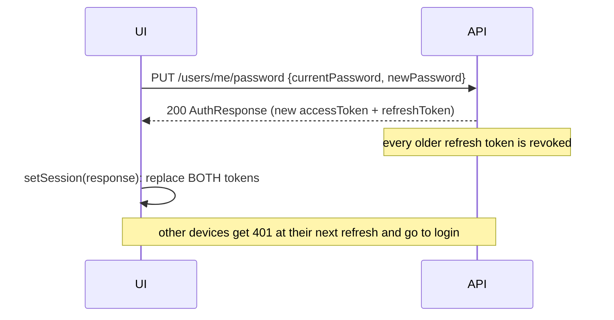

# My Profile: Frontend Implementation Guide

How to build the **"My profile"** area so a signed-in user can view and edit their details and change their
email, phone number and password. It works for every role (Admin, staff, Buyer, Citizen).

This is a focused companion to the main **[Frontend Integration Guide](FRONTEND_INTEGRATION_GUIDE.md)**. The
conventions there still apply: base URL, camelCase JSON, string enums, the error format and the reference API
client in §12 of that guide. This page reuses that client's `api()`, `setSession()` and `ApiError`.

---

## Contents

1. [At a glance](#1-at-a-glance)
2. [TypeScript types](#2-typescript-types)
3. [API functions](#3-api-functions)
4. [Screens and flows](#4-screens-and-flows)
5. [Error handling](#5-error-handling)
6. [Citizen accounts: what a phone change does](#6-citizen-accounts-what-a-phone-change-does)
7. [Security rules the UI must respect](#7-security-rules-the-ui-must-respect)
8. [Testing it locally](#8-testing-it-locally)
9. [Checklist](#9-checklist)

---

## 1. At a glance

All endpoints need `Authorization: Bearer <accessToken>` and act on **the signed-in user only**. There is no
user ID in the URL.

| Action | Method and path | Body | Needs current password | Success response |
|---|---|---|---|---|
| Load profile | `GET /api/v1/users/me` | none | no | `UserProfile` |
| Edit name and gender | `PUT /api/v1/users/me` | `{ fullName, gender }` | no | `UserProfile` |
| Change email | `PUT /api/v1/users/me/email` | `{ newEmail, currentPassword }` | **yes** | `UserProfile` |
| Change phone | `PUT /api/v1/users/me/phone` | `{ phone, currentPassword }` | **yes** | `UserProfile` |
| Change password | `PUT /api/v1/users/me/password` | `{ currentPassword, newPassword }` | **yes** | `AuthResponse` (**new tokens**) |

The email, phone and password endpoints use the **auth rate limit** (10 requests per minute per IP) and count wrong
passwords towards the **login lockout** (5 wrong attempts lock the account for 15 minutes).

### Sample `UserProfile`

```json
{
  "id": "6f1c0c9e-...",
  "email": "aminata@example.com",
  "fullName": "Aminata Kamara",
  "gender": "Female",
  "maskedPhone": "+232 ** *** 3456",
  "roles": ["Citizen"],
  "isActive": true,
  "createdAt": "2026-10-30T10:09:15Z"
}
```

- `maskedPhone` is `null` when the user has no phone on file. **The API never returns the full number**, not even
  to its owner. Show the masked value, and leave the input empty when the user edits it.
- `email` and `roles` are read-only on the main profile form. Email has its own flow; roles are managed by an
  Admin (`PUT /users/{id}/roles`).

---

## 2. TypeScript types

```ts
// src/api/types.ts (add or replace)
export type Gender = "Unspecified" | "Female" | "Male" | "Other";

export interface UserProfile {
  id: string;
  email: string;
  fullName: string;
  gender: Gender;
  maskedPhone: string | null;
  roles: Role[];
  isActive: boolean;
  createdAt: IsoDateTime;
}

export interface UpdateProfileRequest { fullName: string; gender: Gender; }
export interface ChangeEmailRequest { newEmail: string; currentPassword: string; }
export interface ChangePhoneRequest { phone: string; currentPassword: string; }
export interface ChangePasswordRequest { currentPassword: string; newPassword: string; }
```

`Role`, `IsoDateTime`, `AuthResponse` and `ProblemDetails` are already defined in §11 of the main guide.

---

## 3. API functions

```ts
// src/api/profile.ts
import { api, setSession } from "./client";
import type {
  AuthResponse, UserProfile, UpdateProfileRequest,
  ChangeEmailRequest, ChangePhoneRequest, ChangePasswordRequest,
} from "./types";

export const getMyProfile = () =>
  api<UserProfile>("/users/me");

export const updateMyProfile = (body: UpdateProfileRequest) =>
  api<UserProfile>("/users/me", { method: "PUT", body });

export const changeMyEmail = (body: ChangeEmailRequest) =>
  api<UserProfile>("/users/me/email", { method: "PUT", body });

export const changeMyPhone = (body: ChangePhoneRequest) =>
  api<UserProfile>("/users/me/phone", { method: "PUT", body });

/** Signs the user out on every other device. Store the returned tokens, or this session dies too. */
export async function changeMyPassword(body: ChangePasswordRequest): Promise<UserProfile> {
  const auth = await api<AuthResponse>("/users/me/password", { method: "PUT", body });
  setSession(auth); // replaces BOTH tokens. Skipping this logs the user out at the next refresh.
  return auth.user;
}
```

After any successful call, **replace your cached user** (the `cl.user` entry in `localStorage`, your auth
store or context, the header avatar and name) with the returned `UserProfile`. Don't rely on the access token's claims for
the name or email: they stay old until the next token refresh.

---

## 4. Screens and flows

A good layout is one **Profile** page with four sections, each with its own form and Save button. Saving one
section must not submit the others.

```
┌ My profile ──────────────────────────────────────────┐
│ Personal details   Full name [__________]            │
│                    Gender    [Female ▾]     [Save]   │
├──────────────────────────────────────────────────────┤
│ Email              aminata@example.com    [Change]   │
├──────────────────────────────────────────────────────┤
│ Phone              +232 ** *** 3456       [Change]   │
├──────────────────────────────────────────────────────┤
│ Password           ••••••••••             [Change]   │
└──────────────────────────────────────────────────────┘
```

### 4.1 Personal details (name, gender)

1. On page load, call `getMyProfile()` and prefill the form.
2. Validate on the client: `fullName` is required, at most 150 characters; `gender` is one of the four enum values.
3. Call `updateMyProfile({ fullName, gender })`. On 200, update the cached user and show "Profile updated".

No password is needed. Gender is used for the inclusion KPI, so keep `Unspecified` as a valid choice
("Prefer not to say").

### 4.2 Change email

Open a dialog with **New email** and **Current password**.

1. Client checks: valid email format, at most 256 characters, different from the current email.
2. Call `changeMyEmail({ newEmail, currentPassword })`.
3. On 200, update the cached user and tell the user: *"Use aminata.k@example.com to sign in from now on."*

The change takes effect immediately; no confirmation email is sent. Sessions stay signed in.

### 4.3 Change phone

Open a dialog with **New phone number** and **Current password**.

1. Accepted formats: `+232XXXXXXXX`, `0XXXXXXXX`, or 8 local digits (`76123456`). Spaces and dashes are fine.
   Use `type="tel"` and `inputmode="tel"`. Leave the full validation to the server; a light client check
   (at least 8 digits) is enough.
2. Call `changeMyPhone({ phone, currentPassword })`.
3. On 200, show the new `maskedPhone`.
4. **Citizen accounts only:** before submitting, show the warning in [§6](#6-citizen-accounts-what-a-phone-change-does).

There is no "remove phone" action: the endpoint always needs a number.

### 4.4 Change password

Open a dialog with **Current password**, **New password** and **Confirm new password**.

1. Client checks: new password at least 10 characters (at most 128); confirmation matches; new ≠ current.
   The server's Identity rules also require an **upper-case letter, a lower-case letter and a digit**.
   Show these rules under the field.
2. Call `changeMyPassword({ currentPassword, newPassword })`. It stores the new tokens for you.
3. On success, show: *"Password changed. You've been signed out on your other devices."*
   The current tab stays signed in.



---

## 5. Error handling

Errors use the standard ProblemDetails format (§3 of the main guide). Validation `errors` keys are **PascalCase**;
lower-case the first letter to map them to fields.

| Status | When | `errors` key / `code` | Show it on |
|---|---|---|---|
| 400 | Wrong current password | `CurrentPassword`: "Current password is incorrect." | Current password field |
| 400 | Email already used by another account | `DuplicateEmail` | New email field |
| 400 | Email invalid | `NewEmail` | New email field |
| 400 | Phone invalid | `Phone`: "Enter a valid Sierra Leone phone number." | Phone field |
| 400 | Phone already linked to another citizen account | `Phone` | Phone field |
| 400 | New password too short, same as current | `NewPassword` | New password field |
| 400 | New password fails Identity rules | `PasswordRequiresUpper`, `PasswordRequiresLower`, `PasswordRequiresDigit`, `PasswordTooShort` | New password field |
| 400 | Name missing or too long | `FullName` | Full name field |
| 401 | Account locked after 5 wrong passwords | `code: "unauthorized"`, detail "temporarily locked…" | Whole page; user is signed out |
| 429 | More than 10 email/phone/password attempts per minute | none | Form: "Too many attempts, wait a minute." |

Map Identity's password codes (and `DuplicateEmail`) to a field yourself, because their keys aren't request property names:

```ts
// src/features/profile/fieldErrors.ts
const FIELD_FOR_KEY: Record<string, string> = {
  CurrentPassword: "currentPassword",
  NewPassword: "newPassword",
  NewEmail: "newEmail",
  DuplicateEmail: "newEmail",
  Phone: "phone",
  FullName: "fullName",
  Gender: "gender",
};

export function toFieldErrors(errors: Record<string, string[]>) {
  const result: Record<string, string> = {};
  for (const [key, messages] of Object.entries(errors)) {
    const field = FIELD_FOR_KEY[key] ?? (key.startsWith("Password") ? "newPassword" : "_form");
    result[field] ??= messages[0];
  }
  return result;
}
```

```ts
// usage in a form submit handler
try {
  await changeMyPassword(values);
  toast.success("Password changed. You've been signed out on your other devices.");
} catch (e) {
  if (e instanceof ApiError && e.status === 400) setErrors(toFieldErrors(e.fieldErrors));
  else if (e instanceof ApiError && e.status === 429) setErrors({ _form: "Too many attempts. Wait a minute and try again." });
  else throw e; // 401 is handled by the client: session cleared → login page
}
```

**About 401 on these forms:** the reference client treats any 401 as "signed out" and clears the session. Here that
only happens when the account is **locked**, which is correct: the user can't sign back in for 15 minutes
anyway. On the login page, explain the lock ("Too many wrong passwords. Try again in 15 minutes.").

---

## 6. Citizen accounts: what a phone change does

For users with the `Citizen` role, the phone number is what links their USSD/SMS sell requests to their account
(`GET /users/me/intake-requests`). When a citizen changes their phone:

- Sell requests made **from the new number** (past and future) appear in their account.
- The **old number is released**. Requests made from it **disappear from their list**, and someone else can
  register with that number later. This protects users when a SIM is recycled to a new owner.
- If the new number is already linked to **another** citizen account, the change is refused (400 `Phone`).

Show a confirmation before submitting:

> **Change your phone number?** Sell requests you made from +232 ** *** 3456 will no longer appear in your
> account. Requests you make by USSD or SMS from the new number will.

For other roles the phone is contact information only; no warning is needed.

---

## 7. Security rules the UI must respect

1. **Always ask for the current password** for email, phone and password changes. Never cache it or prefill it,
   and clear the field after every attempt, successful or not.
2. **Store the tokens returned by a password change.** Not doing so revokes the current session at the next refresh.
3. Use `autocomplete` hints so password managers work: `current-password` on the current password,
   `new-password` on the new and confirm fields, `email` on the new email, `tel` on the phone.
4. Disable the Save button while a request is in flight, so a double click doesn't count as two wrong attempts.
5. Don't show the full phone number anywhere, even right after the user typed it. Show the masked value
   returned by the API.
6. After a password change, other open tabs of the same browser share the stored refresh token (if you use
   `localStorage`), so they keep working. Other browsers and devices are signed out.

---

## 8. Testing it locally

1. Run the API (`dotnet run --project src/CircuLedger.Api`, base URL `http://localhost:5097`) with demo data on.
2. Sign in as the demo buyer: `buyer@circuledger.local` with the demo password (`DEMO_PASSWORD` in `.env`,
   `ChangeMe!Demo2026` in `.env.example`).
3. Try the ready-made requests in **[`CircuLedger.http`](../CircuLedger.http)** under *My profile*. The email and
   password requests are commented out so a full run doesn't change the demo login. Uncomment them to try them.
4. To test the citizen flow, register a new account with `"accountType": "Citizen"` and a `phone` using
   `POST /auth/register`, then change its phone.
5. Swagger (`/swagger`) lists the exact schemas under **Users**.

> Changing the demo accounts' email or password breaks the shared demo logins for everyone on that environment.
> Prefer a freshly registered account for testing.

---

## 9. Checklist

- [ ] Profile page loads `GET /users/me` and shows `maskedPhone` (or "No phone added").
- [ ] Personal details form sends only `fullName` and `gender`.
- [ ] Email, phone and password dialogs each ask for the current password and clear it afterwards.
- [ ] Password change calls `setSession()` with the response.
- [ ] Cached user (header, avatar, `cl.user`) is replaced after every successful save.
- [ ] Citizens see the phone-change warning before submitting.
- [ ] Field errors map from PascalCase keys, including `DuplicateEmail` and Identity password codes.
- [ ] 429 shows a "wait a minute" message; a locked account (401) lands on the login page with an explanation.
- [ ] Save buttons are disabled while a request is in flight.
- [ ] Correct `autocomplete` attributes on every password, email and phone input.
